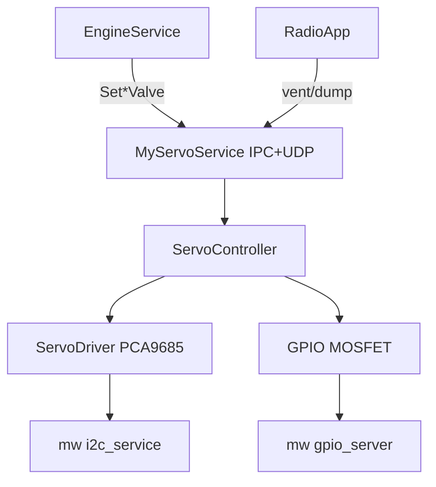
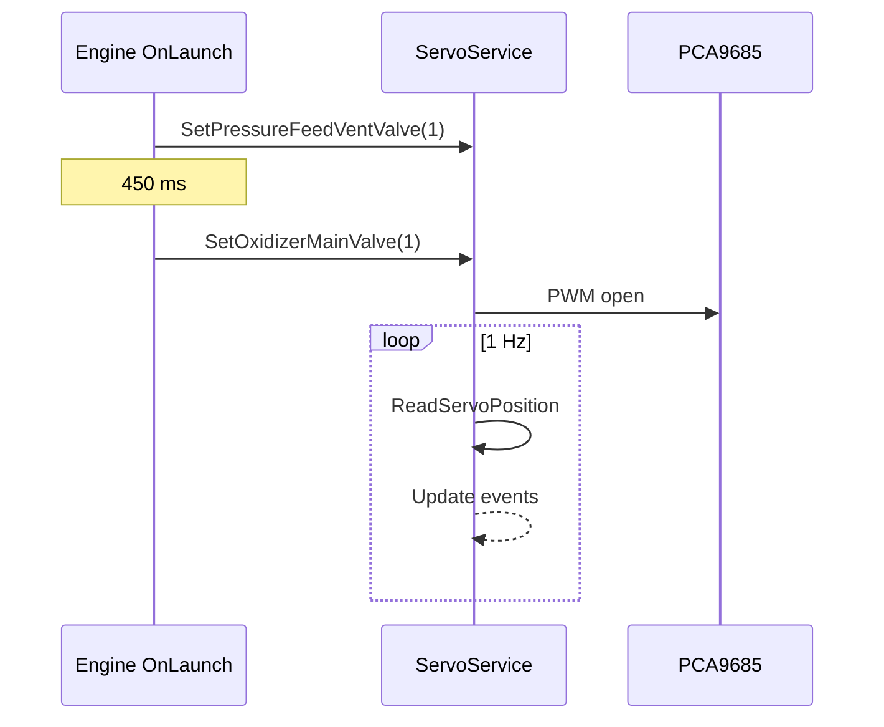

# ServoService (EC)

Sterowanie zaworami utleniacza i Pressure Feed System przez PCA9685 (PWM) + MOSFET-y zasilania.

## TL;DR

SOME/IP `ServoService` (id **515**) otwiera/zamyka 5 zaworów. Pozycje publikuje eventami 1 Hz. Silnik (`engine_service`) i radio (vent/dump przy ARM) są głównymi klientami.

## Opis funkcjonalności

- `ServoController` mapuje stan `0=close` (`off_pos`), `1=open` (`on_pos`) na impulsy PCA9685. Stan `2` ustawia `off_pos` (jak `0`), ale pomija auto-close i pulsowanie; wartości >2 są odrzucane.
- Kalibracja: `on_pos`/`off_pos` z JSON to kąty 0–180° → ticki PCA 102–512 (0,5–2,5 ms), mnożone przez `pca9685_XO_corelation` z EEPROM.
- Wątki: auto-close (`auto_closing_time`, ms) i pulsing (`pulsing_time_ms`, ms; w deploymencie tylko vent utleniacza, 250 ms).
- Heartbeat GPIO pin **4**.
- Zasilanie serw: piny `arm_pins` włącza engine przy ARM/DISARM; dodatkowo przed każdym ruchem `ServoDriver` ustawia pin `mosfet_id` z config.json (bez wyłączania).

### Zawory

| ID | Zawór | Metoda | Event |
|---:|-------|--------|-------|
| 60 | Oxidizer main | `SetOxidizerMainValve` (1) | `newOxidizerMainValveEvent` (32769) |
| 61 | Oxidizer vent | `SetOxidizerVentValve` (3) | `newOxidizerVentValveEvent` (32770) |
| 62 | Oxidizer dump | `SetOxidizerDumpValve` (5) | `newOxidizerDumpValveEvent` (32771) |
| 63 | PFS main | `SetPressureFeedMainValve` (7) | `newPressureFeedMainValveEvent` (32772) |
| 64 | PFS vent | `SetPressureFeedVentValve` (9) | `newPressureFeedVentValveEvent` (32773) |

Wejście metody: `uint8` (0/1/2) → `bool`. Event: ostatnio zadany stan `uint8` (z pamięci kontrolera, nie odczyt z PCA9685).

## Architektura

## API SOME/IP

- **Service:** `srp.apps.ServoService`
- **service_id:** 515, v1.0
- Metody i eventy: tabela powyżej.
- Oferty: IPC + UDP (jak inne app).

## Diagnostyka UDS

| DID | sub_service | Rola |
|-----|-------------|------|
| MainServoStatus | 10 | status main |
| VentServoStatus | 11 | status vent |
| DumpServoStatus | 18 | status dump |
| ServoDid | 21 | zapis kalibracji `[id][open_hi][open_lo][close_hi][close_lo]` (kąty jak `on_pos`/`off_pos`) |

Uwaga: klasy handlerów (`servo_service_did.h`, `servo_did.h`) nie są tworzone w `ServoService::Initialize`, więc DID-y są zadeklarowane w modelu, ale w tej aplikacji nie mają implementacji.

## Konfiguracja

`deployment/apps/servo_service/config.json` (w runtime `etc/config.json`): tablica `servos` z polami `actuator_id`, `channel`, `on_pos`, `off_pos`, opcjonalnie `mosfet_id`, `auto_closing_time`, `pulsing_time_ms`; model w `app_config.json`.

## Zależności

`mw/gpio_server`, `mw/i2c` (PCA9685, EEPROM), `ServoController` współdzielony z SEC_EC i recovery.

## BUILD

- `//apps/ec/ServoService:ServoService`
- Deploy: `//deployment/apps/servo_service:servoService`
