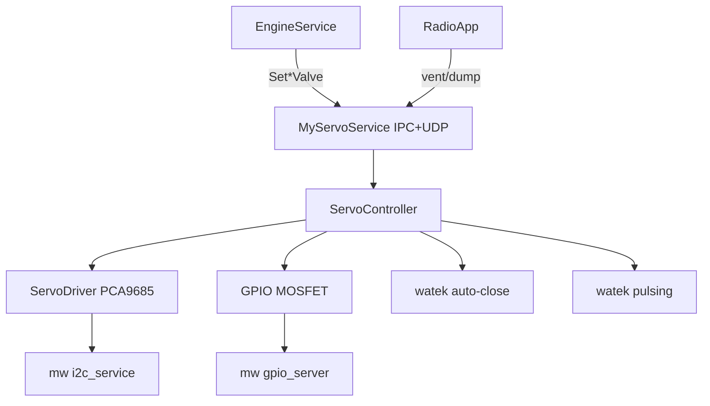
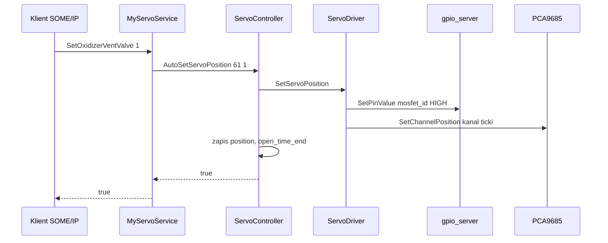
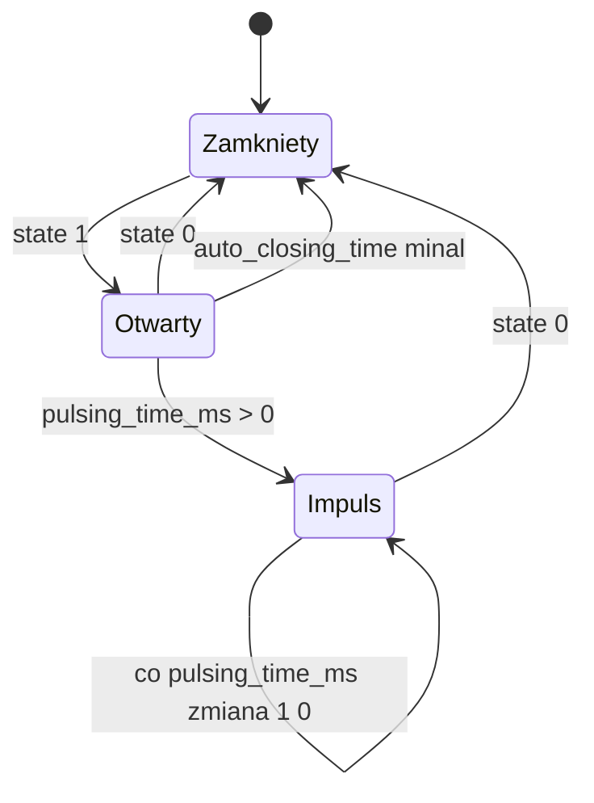

# ServoService (EC)

Sterowanie zaworami utleniacza i Pressure Feed System przez PCA9685 (PWM) + MOSFET-y zasilania.

## TL;DR

SOME/IP `ServoService` (id **515**) otwiera/zamyka 5 zaworów. Pozycje publikuje eventami 1 Hz. Silnik (`engine_service`) i radio (vent/dump przy ARM) są głównymi klientami.

## Opis funkcjonalności

- `ServoController` mapuje stan `0=close` (`off_pos`), `1=open` (`on_pos`) na impulsy PCA9685. Stan `2` ustawia `off_pos` (jak `0`), ale pomija auto-close i pulsowanie; wartości >2 są odrzucane.
- Kalibracja: `on_pos`/`off_pos` z JSON to kąty 0–180° → ticki PCA 102–512 (0,5–2,5 ms), mnożone przez `pca9685_XO_corelation` z EEPROM.
- Wątki: auto-close (`auto_closing_time`, ms) i pulsing (`pulsing_time_ms`, ms; w deploymencie tylko vent utleniacza, 250 ms).
- Heartbeat GPIO pin **4**.
- Zasilanie serw: piny `arm_pins` włącza engine przy ARM/DISARM; dodatkowo przed każdym ruchem `ServoDriver` ustawia pin `mosfet_id` z config.json (bez wyłączania).

### Zawory

| ID | Zawór | Metoda | Event |
|---:|-------|--------|-------|
| 60 | Oxidizer main | `SetOxidizerMainValve` (1) | `newOxidizerMainValveEvent` (32769) |
| 61 | Oxidizer vent | `SetOxidizerVentValve` (3) | `newOxidizerVentValveEvent` (32770) |
| 62 | Oxidizer dump | `SetOxidizerDumpValve` (5) | `newOxidizerDumpValveEvent` (32771) |
| 63 | PFS main | `SetPressureFeedMainValve` (7) | `newPressureFeedMainValveEvent` (32772) |
| 64 | PFS vent | `SetPressureFeedVentValve` (9) | `newPressureFeedVentValveEvent` (32773) |

Wejście metody: `uint8` (0/1/2) → `bool`. Event: ostatnio zadany stan `uint8` (z pamięci kontrolera, nie odczyt z PCA9685).

## Architektura



## Cykl życia

1. `Initialize`: brak `app_path` → zwraca 1. Tworzy `ServoController` i woła `Init(app_path)`:
   - `LoadServoConfig(app_path + "etc/config.json")` — brak pliku lub tablicy `servos` → `LogError` i pusta baza (aplikacja nadal startuje, bez zaworów);
   - `ServoDriver::Init`: `PCA9685::Init` (wynik ignorowany), odczyt konfiguracji EEPROM ([24LC32AT](../../../mw/i2c_service/controller/24lc32at/README.md)); **brak odczytu EEPROM → `LogFatal` i `exit(1)`**;
   - start wątków auto-close i pulsing;
   - wymuszenie stanu `0` (`off_pos`) na każdym skonfigurowanym zaworze (`force=true`).
2. Tworzy skeletony IPC i UDP (oferta startuje dopiero w `Run`).
3. `Run`: `StartOffer`; pętla co 1 s — heartbeat pin 4 (impuls 500 ms) i odczyt pozycji 5 zaworów → eventy. Brak skeletonów → zwraca 1.
4. Zatrzymanie: `StopOffer` IPC i UDP; wątki kończą się z destruktorem `ServoController`.

## Przepływ danych (kąt → PWM)

```
kąt [°] (on_pos / off_pos z JSON)  →  clamp 0..180
µs    = (kąt · 2000 + 90) / 180 + 500           (500 … 2500 µs)
ticki = µs · 4096 / 20000                       (102 … 512, okres 20 ms = 50 Hz)
PWM   = ticki · pca9685_XO_corelation           (float z EEPROM, obcięty do uint16)
```

`PWM` trafia do rejestrów OFF kanału PCA9685 (`ON = 0`), por. [PCA9685](../../../mw/i2c_service/controller/pca9685/README.md). Przy `state==1` użyty jest `on_pos`, w pozostałych przypadkach `off_pos`.



## Auto-close i pulsing



- **Auto-close**: wątek co ≤ 1 s sprawdza zawory z `auto_closing_time > 0` otwarte (`position != 0`); gdy `open_time_end` minął → `SetServoPosition(0)`. Każde otwarcie ustawia `open_time_end = max(poprzedni, teraz + auto_closing_time)`.
- **Pulsing**: dla zaworu z `pulsing_time_ms > 0` każde ustawienie stanu ≠ 2 tworzy wpis z deadline; wątek co `pulsing_time_ms` przełącza pozycję otwarty/zamknięty (stan raportowany w `position` pozostaje zadany). Po zadaniu `0` wpis jest usuwany, a zawór zamykany.

## Obsługa błędów

| Sytuacja | Zachowanie |
|----------|------------|
| nieznany `actuator_id` | `AutoSetServoPosition` → `false` → SOME/IP `kUnsetFailure` |
| wartość >2 | `kFieldValueIsNotValid` |
| ten sam stan co zapisany (bez `force`) | `true` bez ruchu |
| błąd zapisu PCA9685 | `Warn`, a `SetServoPosition` i tak zwraca `true` (stan zapisany jako wykonany) |
| błąd włączenia MOSFET | `LogError`, ruch PWM nadal wykonywany |
| odczyt EEPROM nieudany przy starcie | `exit(1)` |
| `ReadServoPosition` dla nieznanego ID | `nullopt` → event pomijany, `Warn` |
| kąt poza 0–180 lub ticki poza 102–512 | przycięcie z logiem `Warn` |

Pozycja w eventach i DID-ach to stan zadany, nie odczyt z PCA9685, więc błąd I2C nie jest widoczny w statusie.

## API SOME/IP

- **Service:** `srp.apps.ServoService`
- **service_id:** 515, v1.0; instancje `ServoService_ipc` i `ServoService_udp`.
- Metody i eventy: tabela powyżej (typ `uint8`).

## Diagnostyka UDS

| DID | sub_service | Rola |
|-----|-------------|------|
| MainServoStatus | 10 | status main |
| VentServoStatus | 11 | status vent |
| DumpServoStatus | 18 | status dump |
| ServoDid | 21 | zapis kalibracji `[id][open_hi][open_lo][close_hi][close_lo]` (kąty jak `on_pos`/`off_pos`) |

DID-y są tworzone w `ServoService::Initialize` i oferowane w `Run` (razem z usługami SOME/IP), zatrzymywane przy zakończeniu.

## Konfiguracja

`deployment/apps/servo_service/config.json` (w runtime `etc/config.json`): tablica `servos`; model w `app_config.json`.

| Pole | Typ | Jednostka | Domyślnie | Opis |
|------|-----|-----------|-----------|------|
| `actuator_id` | uint8 | — | wymagane | 60–64 |
| `channel` | uint8 | — | wymagane | kanał PCA9685 (0–15) |
| `on_pos` | uint16 | ° (0–180) | wymagane | kąt „otwarty” |
| `off_pos` | uint16 | ° | wymagane | kąt „zamknięty” |
| `mosfet_id` | uint8 | pin gpio | 0 (brak) | MOSFET zasilania, włączany przed ruchem i nie wyłączany |
| `auto_closing_time` | uint16 | ms | 0 (wyłączone) | auto-zamknięcie |
| `pulsing_time_ms` | uint16 | ms | 0 (wyłączone) | okres przełączania |
| `ina219_address` | uint8 | adres I2C | 0 | odczytywane, nie używane przez kod |

Niekompletny wpis (brak pola wymaganego) jest pomijany z `Warn`. Dodatkowo z EEPROM: `pca9685_XO_corelation` (mnożnik ticków, `float`).

## Zależności

`mw/gpio_server`, `mw/i2c_service` (PCA9685, EEPROM; INA219 jest zlinkowany, lecz nieużywany), `ServoController` współdzielony z SEC_EC i recovery.

## BUILD

- `//apps/ec/ServoService:ServoService`
- Deploy: `//deployment/apps/servo_service:servoService`
- Testy: brak UT w module.
