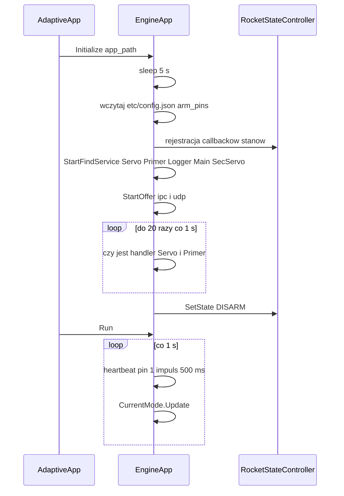
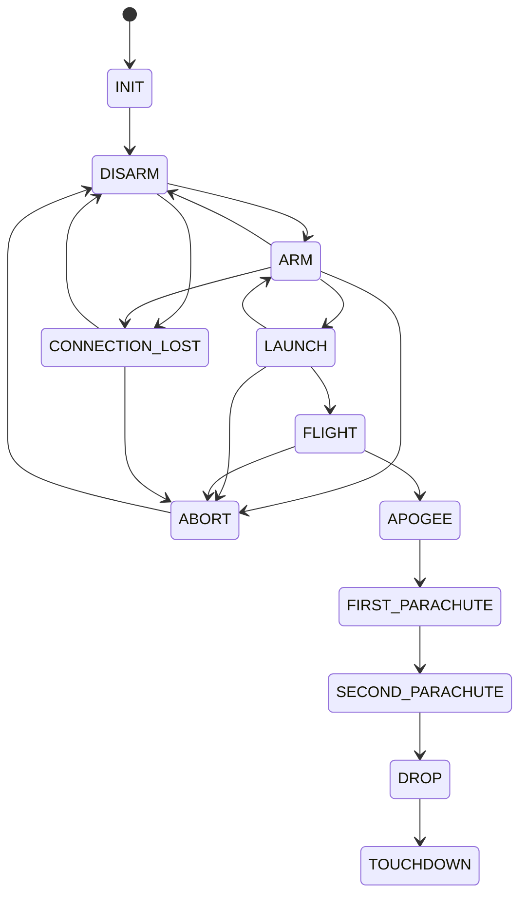

# engine_service (EC)

Główny sekwencer napędu na Engine Computer.

## TL;DR

Właściciel maszyny stanów rakiety na EC. SOME/IP `EngineService` (id **518**) przyjmuje `SetMode` (z radia / `main_service` na FC) i wykonuje ARM, LAUNCH (primer + zawory), APOGEE (dump/vent) i ABORT (blowdown). Stan jest publikowany jako `CurrentMode`. Przejścia pilnuje `core::rocketState::RocketStateController`, a aplikacja podpina pod nie akcje na GPIO i serwach.

## Opis funkcjonalności

Po starcie czeka 5 s, ładuje `arm_pins` z JSON, wyszukuje Primer/Servo/SecServo/Main/Logger, czeka do 20 s na Primer i Servo (bez nich kończy się błędem) i przechodzi w `DISARM`; SecServo/Main/Logger nie są czekane.

Publikuje `CurrentMode` co 1 s i na zmianie stanu. Heartbeat GPIO pin **1** (impuls 500 ms co ok. 1 s).

### Akcje stanów

| Stan (wartość) | Działanie |
|----------------|-----------|
| **ARM** (2) | GPIO zasilania actuatorów HIGH (MS, VS, PFMS, PFVS, DS, IP) |
| **DISARM** (1) / **CONNECTION_LOST** (54) | piny LOW; `SetOxidizerVentValve(0)` + `SetOxidizerDumpValve(0)` |
| **LAUNCH** (3) | wątek: `StartPrime` → 1 s → PFS vent open → 450 ms → oxi main open → 7 s → **ABORT** |
| **APOGEE** (5) | dump + vent open; piny VS/PFVS/MS zostają HIGH 3,5 s (force), reszta OFF |
| **ABORT** (64) | close main → 200 ms → close PFS vent → 200 ms → close PFS main → 5 s → reopen main → 200 ms → PFS vent (zrzut); wykonywany tylko gdy znaleziono Servo i SecServo |

Wymaganie ARM: muszą istnieć handlery Primer i Servo.

## Cykl życia

1. `Initialize`: brak parametru `app_path` → zwraca 1 (bez czekania). Po 5 s ładuje `app_path + "etc/config.json"`; brak pliku, brak tablicy `arm_pins` albo zero poprawnych wpisów → `LogError`, zwraca 1.
2. Rejestruje wymagania ARM, callback zmiany stanu (publikacja `CurrentMode`) i akcje stanów, startuje wyszukiwanie usług i ofertę IPC + UDP.
3. Pętla oczekiwania na handlery Servo i Primer: do 20 iteracji po 1 s. Gdy po pętli licznik osiągnął 20 → `LogFatal` i zwraca 1 (dotyczy też sytuacji, gdy handler pojawił się w ostatniej sekundzie).
4. `SetState(DISARM)` (z `INIT`) wywołuje `OnDisarm`: piny LOW, vent i dump zamykane.
5. `Run`: co 1 s heartbeat (`SetPinValue(1, 1, 500)`; niepowodzenie → `Warn`) i `CurrentMode.Update` na obu skeletonach.
6. Zatrzymanie: `StopOffer` (IPC, UDP), `StopFindService` dla Servo, Primer i Main (Logger i SecServo bez).

## Maszyna stanów

Dozwolone przejścia (`rocket_state.cpp`); `SetMode` z innym przejściem lub tym samym stanem zwraca `false` (log `Warn`/`Info`):

`SetState` trzyma mutex kontrolera podczas wykonania callbacków (akcje `OnArm`, `OnDisarm`, `OnApogee` wykonują się synchronicznie w wywołaniu `SetMode`). `OnLaunch` i `OnAbort` uruchamiają odłączone wątki.

## Obsługa błędów

| Sytuacja | Zachowanie |
|----------|------------|
| brak configu / `arm_pins` | `Initialize` zwraca 1 — aplikacja nie startuje |
| brak Servo lub Primer po 20 s | `LogFatal`, `Initialize` zwraca 1 |
| `SetMode(ARM)` bez handlerów Primer/Servo | odrzucone (`false`), `LogError` |
| błąd GPIO w `OnArm` / `OnApogee` / `OnDisarm` | `LogError` z nazwą pinu, pozostałe piny nadal obsługiwane |
| `StartPrime` w LAUNCH | wynik ignorowany (sprawdzenie zakomentowane), sekwencja trwa dalej |
| ABORT bez SecServo lub Servo | `OnAbort` kończy się bez żadnej akcji |
| nieudany heartbeat | `Warn`, bez skutku na stan |
| LAUNCH → po 7 s `SetState(ABORT)` | wykonywane bezwarunkowo; odrzucone przez tabelę przejść, jeśli stan to np. DISARM |

Brak ponowień wywołań serwo/primer; błędy SOME/IP w wywołaniach `SetOxidizer…Valve` nie są sprawdzane.

## API SOME/IP

**Service:** `srp.apps.EngineService`, **id 518**

| Rodzaj | Nazwa | ID | Typ |
|--------|-------|---:|-----|
| Method | `SetMode` | 2 | `uint8` (`RocketState_t`) → `bool` (przyjęte) |
| Event | `CurrentMode` | 32769 | `uint8` (`RocketState_t`) |

Instancje: `EngineService_ipc` (lokalnie) i `EngineService_udp`. Wywołujący `SetMode`: radio, `main_service` (FC).

## Konfiguracja

`etc/config.json` — tablica `arm_pins`: `{id, desc, func}`.

| Pole | Typ | Wymagane | Opis |
|------|-----|----------|------|
| `id` | uint8 | tak | `pin_id` w `gpio_server` |
| `func` | string | tak | `PFVS`, `MS`, `VS`, `PFMS`, `DS`, `IP` — `VS`, `PFVS`, `MS` mają specjalne traktowanie w APOGEE |
| `desc` | string | nie | nazwa w logach |

Wpisy bez `id` lub `func` są pomijane. W deployment: pin 9=PFVS, 5=MS, 6=VS, 7=PFMS, 14=DS, 8=IP. Stałe w kodzie: heartbeat pin 1, start po 5 s, czekanie ≤ 20 s.

## Zależności

`RocketStateController`, GPIO MW, proxy: Primer, Servo, SecServo, MainService, FileLogger.

## BUILD

- `//apps/ec/engine_service:engine_service`
- Deploy: `//deployment/apps/engine_app:EngineService`
- Testy: brak UT w module i w `core/rocket_machine_state`; sekwencje (LAUNCH/ABORT) sprawdzane tylko na emulatorze/sprzęcie.
