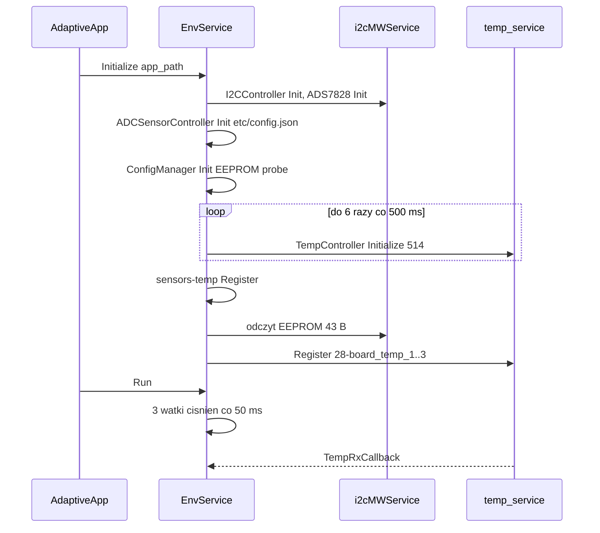

# env_service (EC)

Telemetria środowiskowa napędu: ciśnienia zbiorników/komory i temperatury 1-Wire.

## TL;DR

SOME/IP `EnvApp` (id **514**) — tylko eventy. ADC ADS7828 co 50 ms (ciśnienie ×100 jako `int16`), trzy temp zbiorników + trzy temp płytki z EEPROM.

## Opis funkcjonalności

- Ciśnienia: sensor_id **10** utleniacz, **11** PFS, **12** komora 1 → eventy 32772–32774.
- Temperatury zbiorników: eventy `newTempEvent_1/2/3` (32769–32771), `int16` (°C × 10).
- Temperatury płytki: `newBoardTempEvent1/2/3` (32775–32777) — ID 1-Wire z EEPROM.
- Subskrypcja `temp_service` z `service_id = 514`.
- Brak metod SOME/IP.

Różnica vs FC: tutaj ciśnienia paliwowe, nie BME/IMU. Vs SEC_EC: tutaj oxi/PFS/komora1, tam etanol i komory 2/3.

## Cykl życia



1. `Initialize` — kolejność kroków i skutki błędów (każdy błąd kończy się `kInitializeError`, aplikacja nie startuje):
   1. brak parametru `app_path`;
   2. `I2CController::Init` (gniazdo `SRP.I2C`) i `ADS7828::Init`;
   3. `ADCSensorController::Init(app_path, adc)` — brak `etc/config.json` lub `nullptr` ADC (brak tablicy `sensors` nie jest błędem, baza jest wtedy pusta);
   4. `TempController` + `ConfigManager::Init` (próbny odczyt EEPROM 0x0000);
   5. `temp_->Initialize(514, ...)`: do 6 prób, przerwa 500 ms przed każdą próbą;
   6. `LoadTempConfig`: brak pliku lub tablicy `sensors-temp` → błąd; wpisy bez `physical_id`/`name` oraz nieudane `Register` są pomijane (`continue`);
   7. odczyt `EEPROM_config` (brak → błąd) i rejestracja trzech czujników płytki jako `28-<board_temp_id>` (nazwy `board_1..3`); nieudana rejestracja → błąd.
2. `Run`: `StartOffer` IPC/UDP, `temp_->StartRxThread()`, trzy `jthread` ciśnień (sensor 10, 11, 12); czeka na stop; `StopOffer`.

## Przepływ danych

```
ADS7828 kanał N → U [V] = raw/4096 · 3,3
ADCSensorController: p [bar] = a · U + b          (a, b z config.json)
EnvService:         int16 = (int16)(p · 100)       → event (bar × 100)
1-Wire (mw/temp):   T [°C] → int16 = (int16)(T · 10) → event (°C × 10)
```

Zakres `int16` to ±327,67 bar i ±3276,7 °C. Wzory `a`/`b` — por. [ADCSensorController](../../../mw/i2c_service/controller/adcsensor/README.md).

Pętla ciśnienia (osobny wątek na czujnik, `GenericPressureLoop`): `GetValue(id)` pod mutexem → przy sukcesie `Update` na IPC i UDP (pod `service_mtx_`) i log `Warn` z wartością w bar; okres = 50 ms minus czas wykonania (`wait_for`). Brak odczytu (`nullopt`) → log `Warn` „Don't receive new …”, **event nie jest publikowany** (odbiorcy zachowują ostatnią wartość).

Temperatury: `TempRxCallback` odwzorowuje `actuator_id` na nazwę (`sensor_temp_1/2/3`, `board_1/2/3`) i aktualizuje odpowiedni event; nieznane ID lub nazwa bez mapowania → `Warn`.

## Obsługa błędów

| Sytuacja | Zachowanie |
|----------|------------|
| błąd inicjalizacji (I2C, ADC, config, EEPROM, temp_service) | `Initialize` zwraca `kInitializeError` — brak fail-safe, aplikacja nie startuje |
| `temp_service` niedostępny przy starcie | 6 prób co 500 ms (≈ 3 s), potem błąd |
| błąd odczytu ADC w trakcie pracy | pominięcie próbki (`Warn`), brak eventu |
| `sensor_id` bez wpisu w configu | `GetValue` → `nullopt`, jak wyżej |
| nieznany czujnik 1-Wire | `Warn`, próbka pominięta |

## API SOME/IP

**Service:** `srp.env.EnvApp`, **id 514**; instancje `envService_ipc`, `envService_udp`.

| Event | ID | Payload |
|-------|---:|---------|
| newTempEvent_1/2/3 | 32769–32771 | int16 (°C × 10) |
| newOxidizerPressEvent | 32772 | int16 (bar × 100) |
| newPressureFeedPressEvent | 32773 | int16 (bar × 100) |
| newChamberPressEvent1 | 32774 | int16 (bar × 100) |
| newBoardTempEvent1/2/3 | 32775–32777 | int16 (°C × 10) |

## Konfiguracja

`deployment/apps/env_service/config.json` (w runtime `etc/config.json`):

| Pole | Typ | Jednostka | Opis |
|------|-----|-----------|------|
| `sensors[].sensor_id` | uint8 | — | 10 / 11 / 12 (stałe w kodzie) |
| `sensors[].channel` | uint8 | — | kanał ADS7828 (0, 1, 2) |
| `sensors[].a`, `b` | float | bar/V, bar | `p = a·U + b`; w deploymencie 41,66667 / −23,98677 (ID 10, 12) i 166,6667 / −99,0 (ID 11) |
| `sensors-temp[].physical_id` | string | — | ID DS18B20, np. `28-0b2554dfd2cc` |
| `sensors-temp[].name` | string | — | `sensor_temp_1/2/3` — wybór eventu |

Stałe w kodzie: okres ciśnień 50 ms, mnożnik 100, `service_id` 514, 6 prób temp_service. Z EEPROM: ID trzech czujników płytki (`board_temp1..3_id`, bez prefiksu `28-`).

## Zależności

`mw/temp` ([README](../../../mw/temp/README.md)), `mw/i2c_service` (ADS7828, ADCSensorController, EEPROM ConfigManager).

## BUILD

- `//apps/ec/env_service:env_service`
- Testy: brak UT w module (kontrolery: `//mw/i2c_service/tests:adcsensor_test`).
