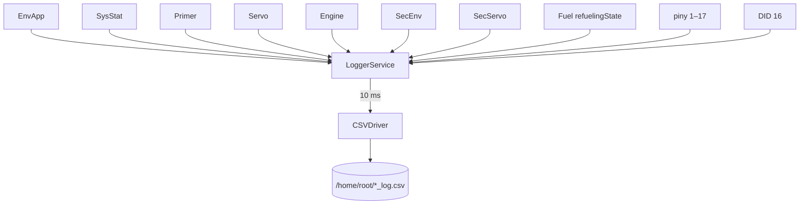
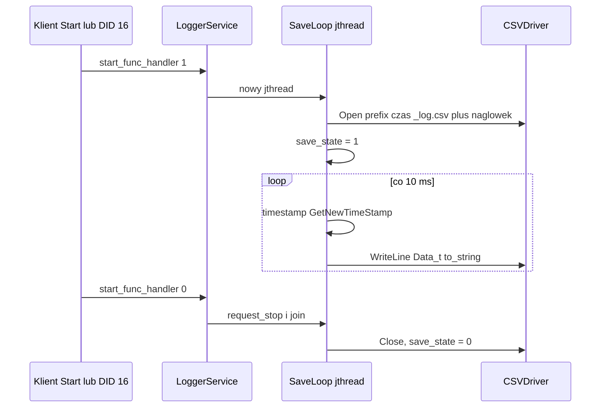

# logger_service (EC)

Pokładowy rejestrator CSV lotu na Engine Computer.

## TL;DR

`FileLoggerApp` (id **517**): `Start`/`Stop` oraz event `LoggingState`. Zapis rusza dopiero po `Start` (lub DID 16 = 1) i kończy się po `Stop` (DID 16 = 0) albo zamknięciu aplikacji; wtedy co **10 ms** dopisuje wiersz do `/home/root/<czas systemowy>_log.csv` z danymi Env, SysStat, Primer, Servo, Engine, **SecEnv**, **SecServo**, stanem tankowania (Fuel) i GPIO 1–17.

## Opis funkcjonalności

- Subskrypcja eventów SOME/IP (IPC/UDP) i pinów GPIO.
- `LoggingState` (0/1) publikowany co 1 s. Heartbeat GPIO pin **2**.
- Znacznik czasu z `TimestampController` (SHM).
- DID 16: zapis 0/1 = stop/start.
- FC ma osobny logger (`FcFileLoggerApp`) z IMU/BME/GPS — ten plik loguje napęd i zawory.

## Architektura

## Cykl życia

1. Konstruktor: buduje DID i skeletony (IPC, UDP) z callbackiem `start_func_handler`, inicjalizuje `TimestampController`. Błąd `timestamp_->Init()` → `LogError`, konstruktor kończy się wcześniej, a aplikacja i tak jest tworzona.
2. `Initialize`: oferuje DID i oba skeletony, uruchamia wyszukiwanie 8 usług (`SomeIpInit`), rejestruje callback GPIO i subskrybuje piny 1–17 (nieudana subskrypcja → `LogError`, kontynuacja). Zawsze zwraca 0.
3. `Run`: co 1 s heartbeat pin 2 (impuls 500 ms) i `LoggingState.Update(save_state)`. Po żądaniu stopu wywołuje `start_func_handler(0)` (zamknięcie pliku) i `StopOffer`.
4. Zapis nie startuje sam — wymaga `Start` (SOME/IP) lub DID 16 = 1.

## Sekwencja zapisu

- Nazwa pliku: `/home/root/` + `ReadSystemTimeAsString()` (pusty prefiks, gdy brak czasu) + `_log.csv`.
- Okres: `10 ms − czas iteracji` (`kSave_interval`).
- `Start` przy działającym zapisie jest ignorowany (jest już wątek); `Stop` bez wątku — też. Obie metody SOME/IP zawsze zwracają `true`.

## Format CSV

Separator `;`, nagłówek w pierwszym wierszu, liczby zmiennoprzecinkowe z 4 miejscami. Wiersz = ostatnie znane wartości (aktualizowane asynchronicznie przez eventy; przed pierwszym eventem są to zera).

| Kolumny | Źródło | Jednostka w pliku |
|---------|--------|-------------------|
| TIMESTAMP | `TimestampController` | ms od startu mastera znacznika czasu (`GetNow() − start`, `high_resolution_clock` w ms) |
| TEMP1–3, BOARD_TEMP1–3 | Env `newTempEvent_*`, `newBoardTempEvent*` | °C × 10 (`int16`, bez przeliczenia) |
| OXIDIZER_PRESS, PRESSURE_FEED_PRESS, CHAMBER_PRESS1 | Env | bar × 100 (wartość eventu zapisana jako `float`, bez dzielenia) |
| CPU_USAGE, MEM_USAGE, DISK_UTILIZATION | SysStat `NewSystemUsage` | jak w evencie |
| PRIMER_STATUS | Primer `primeStatusEvent` | 0–4 (`PrimerState_t`) |
| OXIDIZER_{MAIN,VENT,DUMP}_VALVE, PRESSURE_FEED_{MAIN,VENT}_VALVE | Servo eventy | 0/1/2 |
| ENGINE_MODE | Engine `CurrentMode` | `RocketState_t` |
| ETHANOL_PRESS, CHAMBER_PRESS2/3, SEC_BOARD_TEMP1–3 | SecEnv | j.w. (bar × 100, °C × 10) |
| ETHANOL_MAIN_VALVE, ETHANOL_VENT_VALVE | SecServo | 0/1/2 |
| GPIO_STATE | callback `gpio_server` | maska 32 bitów: bit `pin_id` = poziom (piny 1–17) |
| REFUEL_STATE_OXI, REFUEL_STATE_PFS | Fuel `refuelingStateEvent` | niski nibble payloadu; wysoki nibble = tank (0=OXI, 1=PFS) |

## Obsługa błędów

| Sytuacja | Zachowanie |
|----------|------------|
| nie da się otworzyć pliku | `LogError`, wątek zapisu kończy się, `save_state` zostaje 0; wskaźnik wątku pozostaje ustawiony, więc kolejny `Start` jest ignorowany do czasu `Stop` |
| `WriteLine` zwraca błąd | `Warn`, zapis trwa dalej |
| brak znacznika czasu (`GetNewTimeStamp` bez wartości) | iteracja pomijana bez opóźnienia (ponawianie w pętli) |
| wyjątek w pętli | zamknięcie pliku, `save_state = 0`, `LogFatal` |
| usługa źródłowa niedostępna | pole zostaje na ostatniej wartości (domyślnie 0); logger nie czeka na usługi |
| `pin_id ≥ 32` w callbacku GPIO | `Warn`, zignorowane |
| DID write o długości ≠ 1 | `kInvalidMessageLengthFormat`; DID read: `kSubFunctionNotSupported` |

## API SOME/IP

**Service:** `srp.apps.FileLoggerApp`, **id 517**; instancje `logService_ipc`, `logService_udp`.

| Rodzaj | Nazwa | ID | Typ |
|--------|-------|---:|-----|
| Method | `Start` | 1 | void → bool |
| Method | `Stop` | 2 | void → bool |
| Event | `LoggingState` | 32769 | uint8 (0/1), co 1 s |

## Diagnostyka

`/srp/apps/FileLoggerApp/logger_did`, `sub_service_id` **16** — write 1 B: 0 = stop, 1 = start (każda inna wartość jest przekazywana do handlera i nie ma efektu).

## Konfiguracja

Brak pliku konfiguracyjnego. Stałe: katalog `/home/root/`, sufiks `_log.csv`, okres 10 ms, GPIO 1–17, heartbeat pin 2.

## Zależności

`core/csvdriver`, `core/timestamp`, GPIO controller, proxy wszystkich serwisów EC + SEC_EC (Env, SysStat, Primer, Servo, Engine, SecEnv, SecServo, Fuel).

## BUILD

- `//apps/ec/logger_service/service:logger_service`
- Testy: `//apps/ec/logger_service/tests:data_type_test` — wszystkie przypadki w pliku są zakomentowane, więc test nie uruchamia żadnego `TEST`.
