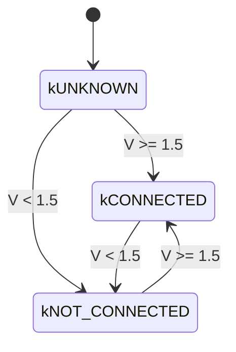
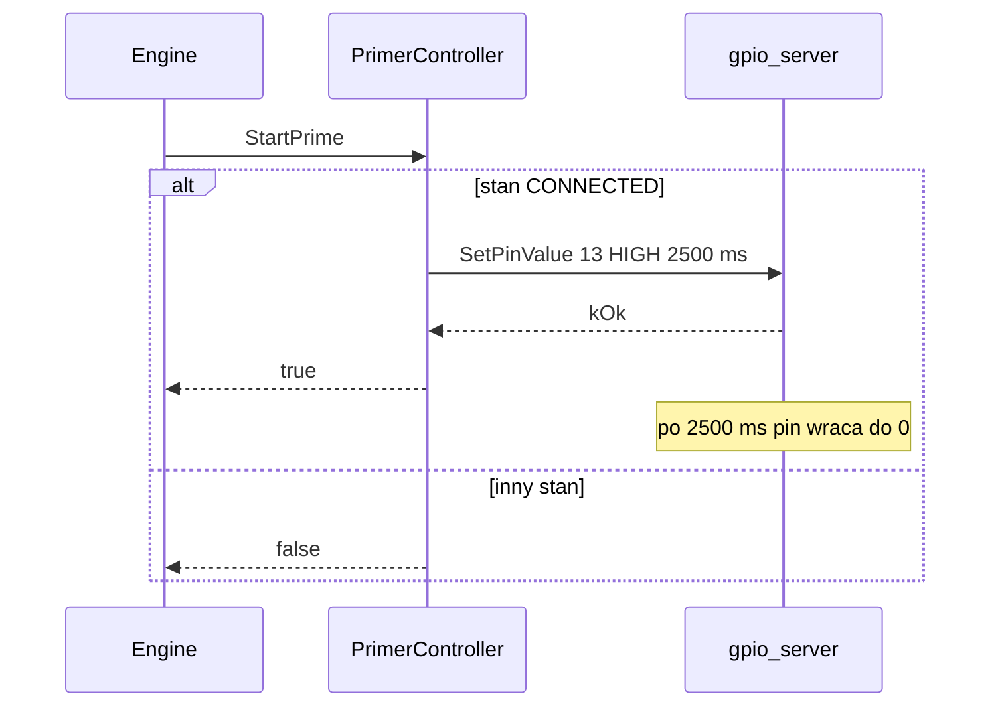

# primer_service (EC)

Zapłonnik / primer — impuls GPIO i diagnostyka ciągłości na ADC.

## TL;DR

`PrimerService` (id **516**): metoda `StartPrime` odpala igniter na pinie 13 na 2500 ms, ale tylko gdy stan to `kCONNECTED` (inaczej zwraca `false`). Event `primeStatusEvent` (co 1 s) zgłasza stan złącza (ciągłość ADS7828 ch3, próg 1.5 V). Wołany przez Engine przy LAUNCH. Heartbeat GPIO pin **3**.

## Opis funkcjonalności

Stany `PrimerState_t`: `kUNKNOWN`(0), `kNOT_CONNECTED`(1), `kCONNECTED`(2), `kSHORT_CIRCUIT`(3), `kFIRED`(4). Kod ustawia tylko `kUNKNOWN`/`kNOT_CONNECTED`/`kCONNECTED` (napięcie ≥ 1.5 V → `kCONNECTED`); `kSHORT_CIRCUIT` i `kFIRED` nie są nigdy ustawiane.

- `EnablePrimer()` — wymaga `kCONNECTED`; GPIO 13 HIGH z `active_time=2500` (parametr `auto_disable` jest ignorowany).
- `VerifyPrimerConection` — odczyt ADC kanał 3 (co 1 s).
- DID 23: pusty write = `EnablePrimer()` (te same warunki); read nieobsługiwany.
- Pin (13) i czas (2500 ms) są stałymi w kodzie; `deployment/apps/prim_service/config.json` nie jest czytany.

## Cykl życia

1. `Initialize`: tworzy `I2CController`, `Init` na gnieździe IPC (wynik ignorowany), przekazuje do `ADS7828`; stan = `kUNKNOWN`; oferuje DID oraz serwis IPC i UDP. Zawsze zwraca 0 — brak I2C nie zatrzymuje aplikacji.
2. `Run` (okres 1 s, `kEvent_interval_ms`): heartbeat pin 3 (impuls 500 ms) → `VerifyPrimerConection()` → publikacja `primeStatusEvent` na IPC i UDP; zmiana stanu jest logowana.
3. Zatrzymanie: `StopOffer` IPC, UDP i DID.

## Przepływ danych (ciągłość)

`ADS7828 ch3` → napięcie `V = raw/4096 · 3,3` → próg `1500 mV / 1000 = 1,5 V`:

Jeśli `GetAdcVoltage` zwróci `nullopt` (brak `i2cMWService`, NACK), stan **nie zmienia się** (zostaje np. `kUNKNOWN`). Log zmiany stanu podpisuje wartość jako „mV”, ale wypisywana jest wartość w woltach. Stała `kIgniter_measurement_adc_samples = 5` nie jest używana (jedna próbka na cykl).

## Odpalenie

Powrót pinu na LOW po 2500 ms wykonuje `gpio_server` (impuls `time_period`). Po odpaleniu stan nie przechodzi w `kFIRED` (przypisanie jest zakomentowane), więc kolejne `StartPrime` w czasie impulsu lub po nim również zostanie przyjęte, dopóki ciągłość ≥ 1,5 V. `DisablePrimer()` działa tylko w `kFIRED`, więc w praktyce zwraca `false` i nie jest wywoływany z żadnego interfejsu.

## Obsługa błędów

| Sytuacja | Zachowanie |
|----------|------------|
| stan ≠ `kCONNECTED` (w tym `kUNKNOWN` przy braku ADC) | `StartPrime` → `false`, `Warn`, pin bez zmian — igniter nie jest odpalany |
| `SetPinValue` zwraca błąd | `LogError`, `StartPrime` → `false` |
| brak odczytu ADC | stan bez zmian, brak logu |
| DID write z niepustym payloadem | `kInvalidMessageLengthFormat` |
| DID write poprawny | zawsze sukces UDS — wynik `EnablePrimer()` jest ignorowany |
| DID read | `kSubFunctionNotSupported` |
| `Engine` | wynik `StartPrime` jest ignorowany przez `engine_service` |

## API SOME/IP

**Service:** `srp.apps.PrimerService`, **id 516**; instancje `PrimService_ipc` i `PrimService_udp`.

| Rodzaj | Nazwa | ID | Typ |
|--------|-------|---:|-----|
| Method | `StartPrime` | 3 | void → bool (przyjęte i GPIO ustawione) |
| Event | `primeStatusEvent` | 32769 | uint8 (`PrimerState_t`), co 1 s |

## Diagnostyka

PrimerDid `/srp/apps/PrimerService/primer_did`, `sub_service_id` **23**: write bez payloadu = `EnablePrimer()`.

## Konfiguracja

Brak pliku konfiguracyjnego. Stałe w kodzie:

| Stała | Wartość | Opis |
|-------|--------:|------|
| `kIgniter_pin_id` | 13 | pin igniter w `gpio_server` |
| `kIgniter_active_time` | 2500 ms | czas impulsu |
| `kIgniter_measureme_adc_channel` | 3 | kanał ADS7828 |
| `kIgniter_connected_treshold_mV` | 1500 | próg ciągłości |
| `kRequire_primer_veryfication` | true | wymóg `kCONNECTED` przed odpaleniem |
| `kHeartBeatPinID` | 3 | heartbeat |

## Zależności

`mw/gpio_server`, `mw/i2c_service` ([ADS7828](../../../mw/i2c_service/controller/ads7828/README.md)).

## BUILD

- `//apps/ec/primer_service:primer`
- Testy: brak UT w module.
