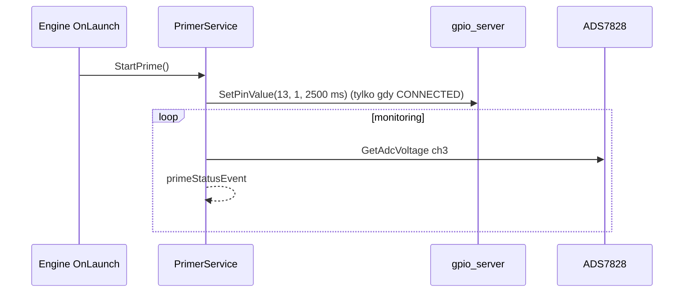

# primer_service (EC)

Zapłonnik / primer — impuls GPIO i diagnostyka ciągłości na ADC.

## TL;DR

`PrimerService` (id **516**): metoda `StartPrime` odpala igniter na pinie 13 na 2500 ms, ale tylko gdy stan to `kCONNECTED` (inaczej zwraca `false`). Event `primeStatusEvent` (co 1 s) zgłasza stan złącza (ciągłość ADS7828 ch3, próg 1.5 V). Wołany przez Engine przy LAUNCH. Heartbeat GPIO pin **3**.

## Opis funkcjonalności

Stany `PrimerState_t`: `kUNKNOWN`, `kNOT_CONNECTED`, `kCONNECTED`, `kSHORT_CIRCUIT`, `kFIRED`. Kod ustawia tylko `kUNKNOWN`/`kNOT_CONNECTED`/`kCONNECTED` (napięcie ≥ 1.5 V → `kCONNECTED`); `kSHORT_CIRCUIT` i `kFIRED` nie są nigdy ustawiane.

- `EnablePrimer()` — wymaga `kCONNECTED`; GPIO 13 HIGH z `active_time=2500` (parametr `auto_disable` jest ignorowany).
- `VerifyPrimerConection` — odczyt ADC kanał 3 (co 1 s).
- DID 23: pusty write = `EnablePrimer()` (te same warunki); read nieobsługiwany.
- Pin (13) i czas (2500 ms) są stałymi w kodzie; `deployment/apps/prim_service/config.json` nie jest czytany.

## Architektura

## API SOME/IP

**Service:** `srp.apps.PrimerService`, **id 516**

| Rodzaj | Nazwa | ID | Typ |
|--------|-------|---:|-----|
| Method | `StartPrime` | 3 | void → bool |
| Event | `primeStatusEvent` | 32769 | uint8 |

## Diagnostyka

PrimerDid, `sub_service_id` **23**.

## Zależności

`mw/gpio_server`, `mw/i2c` (ADS7828).

## BUILD

- `//apps/ec/primer_service:primer`
