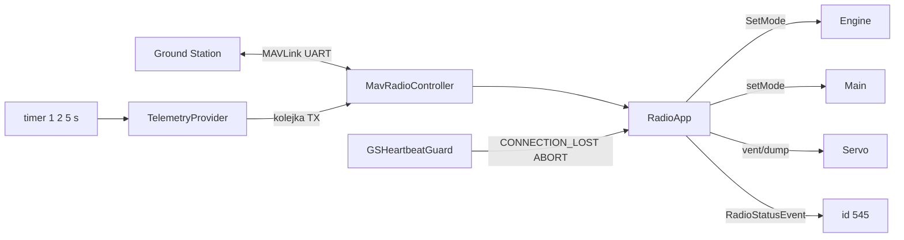
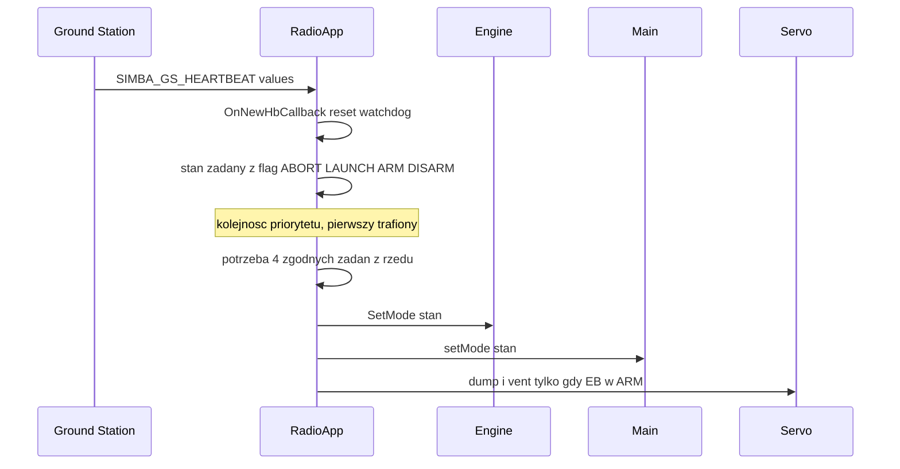
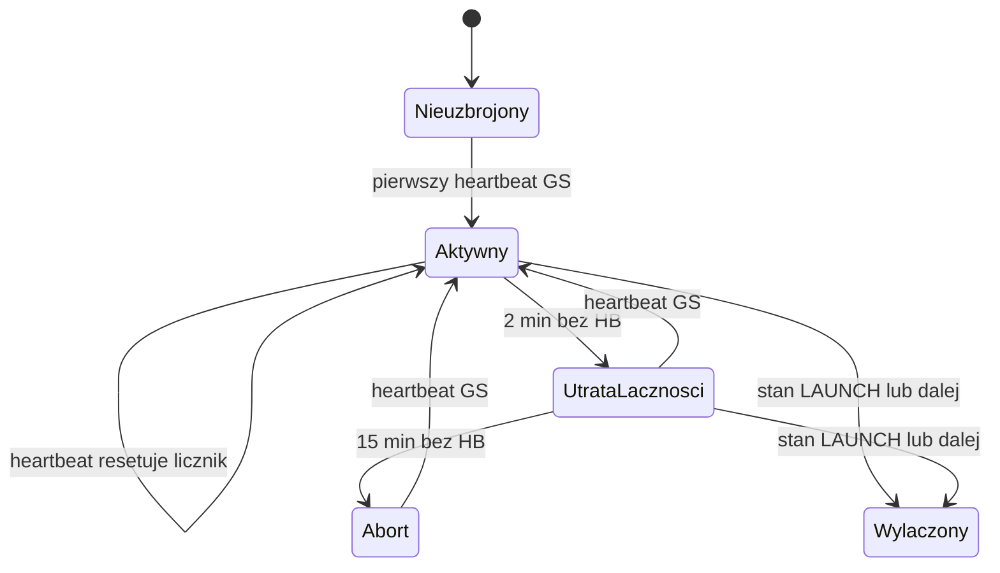

# radio_service (EC)

Most GS ↔ rakieta po MAVLink (UART). Źródła EC; na platformie **w pakiecie FC** leci pełniejszy wariant — ten kod ma zredukowany TX i skeleton `FcRadioService`.

## TL;DR

`FcRadioService` (id **545**) na UART `/dev/ttyS1` @ 57600. RX: heartbeat GS (stan + aktuatory, **4 identyczne ramki**), RADIO_STATUS, komendy tankowania (→ FuelService), masa rakiety i ciśnienia zbiorników GSE (→ eventy). TX: HB i max alt co 5 s, GPS co 2 s, status tankowania co 1 s i przy zmianie (tank/computer telem wyłączone). Timeout: 2 min → CONNECTION_LOST, 15 min → ABORT (tylko przed LAUNCH; od LAUNCH wzwyż utrata łączności nic nie robi).

## Opis funkcjonalności

- `MavRadioController` — odczyt/zapis MAVLink.
- `SomeIPController` — proxy Engine, Main, Servo, Fuel, Primer, Env, EnvFc, GPS, Recovery.
- `TelemetryProvider` — składanie ramek TX.
- `GSHeartbeatGuard` — watchdog łączności.
- Przy ARM heartbeat GS może sterować vent/dump.
- Heartbeat GPIO pin **2**.

**Uwaga:** `deployment/cpu/ec/BUILD` pakuje tę aplikację jako `//deployment/apps/radio_app:RadioApp`. Pełniejszy wariant na locie to FC radio.

## Architektura

## Cykl życia

1. `Initialize`: pobiera `EventData` (singleton z ostatnimi stanami z SOME/IP), rejestruje cztery timery TX i callbacki `SomeIPController` (zmiana stanu tankowania → natychmiastowy status, komenda zaworu GS → ramka `GS_VALVE_CMD`). Zawsze `kOk`.
2. `Run`: `MavRadioController::Init` otwiera `/dev/ttyS1` (57600, timeout 10) — **błąd otwarcia → `LogError` i `exit(1)`**; startuje wątki RX i TX. Następnie `GSHeartbeatGuard::Init`, `timer_ctr_.Start()`, `StartOffer` IPC/UDP. Pętla: heartbeat GPIO pin 2 (impuls 500 ms co 1 s).
3. Zatrzymanie: `timer_ctr_.Stop()`, `StopOffer`.

Wątki: **RX** (`WaitForData(250 ms)` → `mavlink_parse_char` → `RxMsgCallback`), **TX** (blokujące `Get` z kolejki → `uart_.Write`), **guard** (co 1 s), wątek timera.

## Odbiór (RX) — GS heartbeat

- `GetReqRocketStateFromGSFlags`: priorytet **ABORT > LAUNCH > ARM > DISARM** (pierwsza ustawiona flaga); brak flag → bez zmiany.
- Zabezpieczenie „pojedyncza wiadomość nie zmienia stanu” (`IsStateChangeApproved`): żądanie musi się powtórzyć **4 razy z rzędu** (`kRequired_mavlink_messages_to_change_state`); inne żądanie zeruje licznik. Liczone tylko, gdy żądany stan różni się od aktualnego stanu EB (przy dostępnym Engine) lub MB (przy dostępnym Main).
- `SetMode` jest wołany na Engine i Main, o ile ich handlery zostały znalezione (brak → `Warn`).
- Zawory: tylko gdy stan EB = ARM. Dump: zmiana tylko przy różnicy wobec ostatniego stanu; vent: **każdy heartbeat** wywołuje `SetOxidizerVentValve(flaga)`. Brak handlera Servo → dump `Warn`, vent bez akcji.

### Pozostałe ramki RX

| msgid | Akcja |
|-------|-------|
| `RADIO_STATUS` | dekodowanie → `RadioStatusEvent` (rxerrors, fixed, rssi, remrssi, txbuf, noise, remnoise) |
| `SIMBA_REFUELING_CMD` | `command==1` → `Fuel.StartRefueling{tank_id,target_value}`; `command==0` → `Fuel.Abort(tank_id)`; brak handlera Fuel → `LogError` |
| `SIMBA_ROCKET_MASS` | `GSERocketMassEvent` (int16) |
| `SIMBA_GS_OXIDIZER_TANK_PRESSURE` / `…_PFS_…` | `GSEOxidizerTankPressEvent` / `GSEPressureFeedSystemTankPressEvent` (uint16) |
| `SIMBA_ACTUATOR_CMD` | obsługa pusta (TODO w kodzie) |
| inne | log `Info` z `msgid` |

## Nadawanie (TX)

| Ramka | Okres | Zawartość |
|-------|------:|-----------|
| `SIMBA_ROCKET_HEARTBEAT` | 5 s | timestamp (ms), stan MB i EB (mapowanie `RocketState_t` → `SIMBA_ROCKET_STATE_*`), flagi aktuatorów, stan primera; pomijana, gdy brak znacznika czasu |
| `SIMBA_MAX_ALTITUDE` | 5 s | maksymalna wysokość z `EventData` |
| `SIMBA_GPS` | 2 s | lon, lat, altitude |
| `SIMBA_REFUELING_STATUS` | 1 s oraz przy zmianie | stany 4 zbiorników |
| `SIMBA_GS_VALVE_CMD` | na zdarzenie | `valve_id`, `position` z `Fuel.gsValveCmdEvent` |

Tank sensors i computers telemetry są zakomentowane w `Initialize`. Mapowanie primera: `kFIRED` i nieznane wartości → `UNKNOWN`; stany rakiety spoza tabeli → `ABORT`. Stała `kHB_send_time_ms` nie jest używana (HB leci co 5000 ms).

## Watchdog GS (`GSHeartbeatGuard`)

- Do pierwszego heartbeatu GS strażnik nie działa (brak timeoutu po starcie).
- **Od stanu LAUNCH wzwyż (LAUNCH … TOUCHDOWN) strażnik jest wyłączony** — utrata łączności z GS w trakcie startu/lotu nic nie robi (jeden wpis Info w logu). Stan odczytywany z `EventData` (komputer EB lub MB w LAUNCH…TOUCHDOWN → bez akcji).
- Pętla co 1 s (przed LAUNCH): `diff ≥ 15 min` → `ABORT`, w przeciwnym razie `diff ≥ 2 min` → `CONNECTION_LOST`; przy trwającej utracie łączności callback jest wołany **co sekundę** (Engine odrzuca powtórzenie tego samego stanu zwracając `false`). Callback to `Engine.SetMode` + `Main.setMode`.
- Ostrzeżenie o opóźnieniu heartbeatu (`> 1,1 s`) liczy różnicę po nadpisaniu `last_hb_time_`, więc faktycznie porównuje czas z samym sobą.

## Obsługa błędów

| Sytuacja | Zachowanie |
|----------|------------|
| UART nie otwiera się | `exit(1)` (w QEMU/środowisku bez `/dev/ttyS1`) |
| brak handlera usługi | `Warn`/`LogError` i pominięcie komendy |
| zła/niepełna ramka MAVLink | parser ją odrzuca, brak callbacku |
| brak znacznika czasu | heartbeat TX pomijany |
| zerwane łącze z GS | patrz watchdog: 2 min CONNECTION_LOST, 15 min ABORT — tylko przed LAUNCH; od LAUNCH bez akcji |

## API SOME/IP

**Service:** `srp.apps.FcRadioService`, **id 545**; instancje `RadioService_ipc`, `RadioService_udp`.

| Event | ID | Payload |
|-------|---:|---------|
| RadioStatusEvent | 32769 | `RadioDataType` |
| GSEOxidizerTankPressEvent | 32770 | uint16 |
| GSERocketMassEvent | 32771 | int16 |
| GSEPressureFeedSystemTankPressEvent | 32772 | uint16 |

Model deklaruje metody `SetGSEOxidizerFillValve` (1) i `SetGSEPFSFillValve` (2) (`uint8` → `bool`), ale `RadioApp` ich nie implementuje; komendy idą MAVLink → proxy innych usług.

## Timeouty GS

| Czas bez HB | Stan |
|-------------|------|
| 2 min | CONNECTION_LOST |
| 15 min | ABORT |

Oba idą jako `EngineService.SetMode` + `MainService.setMode`, ale tylko przed stanem LAUNCH (od LAUNCH wzwyż strażnik nic nie robi).

## Konfiguracja

Brak pliku. Stałe: `/dev/ttyS1`, 57600 bd, 4 wymagane ramki zmiany stanu, okresy TX jak w tabeli, heartbeat pin 2.

## Zależności

`core/uart`, `core/onTimerCallback`, GPIO, MAVLink dialect `simba`.

## BUILD

- `//apps/ec/radio_service:radio_service`
- Testy: `ut/BUILD` (`radio_app_test`, `event_data_test`) jest w całości zakomentowany — brak aktywnych UT.
