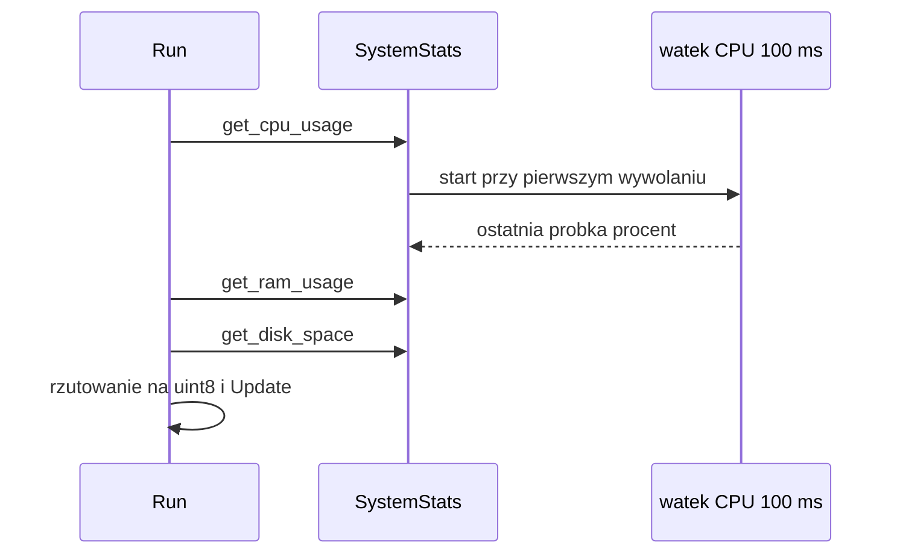

# system_stat_service (EC)

Publikacja obciążenia CPU / RAM / dysku.

## TL;DR

`SysStatService` (id **522**) co 1 s wysyła `NewSystemUsage` z `core::stat::SystemStats` (wartości w %). Pola `SysStatType` są `float32`, ale EC rzutuje je wcześniej do **uint8** (część całkowita); FC ma osobny serwis (`FcSysStatType`) z pełnym float.

## Opis funkcjonalności

Pętla 1 Hz: `get_cpu_usage` (% z próbkowania `/proc/stat` co 100 ms, nie średnia 1 min), `get_ram_usage` (`/proc/meminfo`: (MemTotal−MemAvailable)/MemTotal), `get_disk_space` (zajęte % partycji `/`) → event SOME/IP; gdy brak próbki CPU/RAM, cykl jest pomijany. Logger EC subskrybuje ten event.

## Cykl życia

1. `Initialize`: tylko `StartOffer` IPC i UDP; zawsze zwraca 0 (brak configu i brak zależności od innych usług).
2. `Run`: pętla `wait_for(1000 ms)` → `GetSysStats()` → przy sukcesie `Update` na obu skeletonach i log `Warn` (tekst loga mówi „cpu usage(1min)”, ale wartość pochodzi z próbkowania 100 ms). Pierwszy event pojawia się po ok. 1 s.
3. Zatrzymanie: `StopOffer` IPC i UDP.

## Architektura

## Przepływ danych

| Metryka | Źródło | Wzór | Zapis w evencie |
|---------|--------|------|------------------|
| `cpu_usage` | `/proc/stat` (pierwsza linia `cpu`), wątek próbkujący co 100 ms | `100 · (Δtotal − Δ(idle+iowait)) / Δtotal`; `Δtotal = 0` → 0 | `uint8` (obcięcie części ułamkowej) → `float32` |
| `mem_usage` | `/proc/meminfo` | `100 · (MemTotal − MemAvailable) / MemTotal` | j.w. |
| `disk_utilization` | `std::filesystem::space("/")` | `100 · (capacity − available) / capacity` | j.w. |

Wątek próbkujący CPU jest uruchamiany (jednokrotnie, `std::call_once`, odłączony) przy pierwszym wywołaniu `get_cpu_usage`; do czasu pierwszej próbki (ok. 100 ms) funkcja zwraca `nullopt`.

## Obsługa błędów

| Sytuacja | Zachowanie |
|----------|------------|
| brak próbki CPU (start, błąd odczytu `/proc/stat`) | `GetSysStats` → `nullopt`, cykl pominięty bez eventu |
| `MemTotal ≤ 0` lub brak `/proc/meminfo` | `get_ram_usage` → `nullopt`, cykl pominięty |
| `std::filesystem::space("/")` rzuca wyjątek | brak `try/catch` w `GetSysStats` |
| błąd odczytu `/proc/stat` w trakcie pracy | wątek próbkujący pomija próbkę i zachowuje poprzednią wartość CPU |

Brak ponowień ani fail-safe — to telemetria, nie wpływa na sekwencje startowe.

## API SOME/IP

**Service:** `srp.apps.SysStatService`, **id 522**; instancje `SysStatService_ipc`, `SysStatService_udp`.

| Event | ID | Payload |
|-------|---:|---------|
| NewSystemUsage | 32769 | `srp.apps.SysStatType` {cpu_usage, mem_usage, disk_utilization} (float32, wartości całkowite 0–100 %) |

## Konfiguracja

Brak. Okres 1000 ms jest stałą w kodzie (`kDelay`).

## Zależności

`//core/sys:system_status`. Odbiorca: `logger_service` (kolumny `CPU_USAGE`, `MEM_USAGE`, `DISK_UTILIZATION`).

## BUILD

- `//apps/ec/system_stat_service:system_stat_service`
- Testy: brak UT w module.
