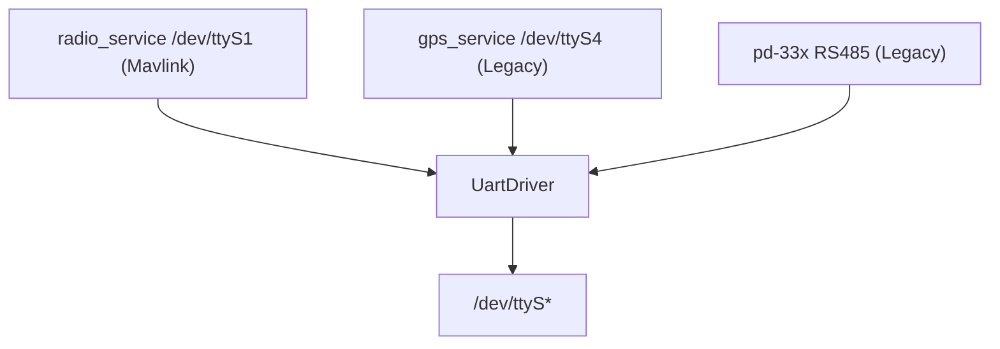

# uart

Sterownik portu szeregowego POSIX (`termios`), jeden dla wszystkich użytkowników; różnice w konfiguracji opisuje `UartConfig`.

## TL;DR

Otwiera UART, czyta i zapisuje bajty. Używany przez radio (MAVLink, tryb raw), GPS (NMEA) i warstwę RS485 (PD-33X) — GPS i RS485 zostają przy dawnym trybie kanonicznym (`UartConfig::Legacy()`). W trybie `--define build_mode=sim` `uart_driver` kompiluje `sim_uart_driver.cpp`: `Open` działa na dowolnej ścieżce, bajty RX wstrzykuje test przez `ctl`, a `Write` ląduje w `events.jsonl` i `state/uart/<port>.tx` (`core/sim/README.md`).

## Opis funkcjonalności

- `Open(port, baudrate, timeout)` — dawny interfejs, deleguje do `Open(port, UartConfig::Legacy(baudrate))`. Parametr `timeout` jest nadal ignorowany (VTIME z presetu).
- `Open(port, UartConfig)` — pełna konfiguracja: prędkość (stała `B…`; liczbę zamienia `GetBaudrateConstant`), bity danych, parzystość, bity stopu, `CRTSCTS`, tryb `raw`/kanoniczny, `VMIN`/`VTIME`, domyślny rozmiar `Read(0)`.
- `WaitForData(timeout_ms)` — `poll(POLLIN)`; true, gdy są dane do odczytu.
- `Read(size)` — `size == 0` oznacza odczyt do `default_read_size` z konfiguracji (256 B w `Legacy`, 512 B w `Mavlink`).
- `Write` — surowe bajty. `Close`.

### Presety (`uart_config.hpp`)

| Preset | Tryb | Użytkownicy | Różnice |
|---|---|---|---|
| `UartConfig::Legacy(baud)` | kanoniczny (nie wyłącza ICANON/ECHO/obróbki wejścia), 8N1, `VMIN=0`, `VTIME=10` | GPS (`apps/fc/gps_service`), RS485/Modbus (`core/pd-33x`) | `Open` ignoruje wynik `tcsetattr`, `Read(0)` do 256 B |
| `UartConfig::Mavlink(baud)` | raw (bez ICANON, ISIG, ECHO*, XON/XOFF, INLCR/ICRNL…, OPOST/ONLCR), 8N1, `VMIN=0`, `VTIME=10` | radio EC i FC (`/dev/ttyS1` @ 57600) | `Open` zwraca `false`, gdy `tcsetattr` się nie powiedzie; `Read(0)` do 512 B |

Preset `Legacy` daje dokładnie te flagi, które ustawiał dawny `core/uart`, a `Mavlink` — które ustawiał dawny driver radia (dowód: `//core/uart/ut:uart_config_test` porównuje wszystkie pola `termios` z kodem referencyjnym z 908a071 dla trzech stanów początkowych).

## Architektura



## API

```cpp
struct UartConfig {  // uart_config.hpp
  speed_t baudrate; uint8_t data_bits; Parity parity; uint8_t stop_bits;
  bool hw_flow_control; bool raw; uint8_t vmin; uint8_t vtime;
  uint16_t default_read_size; bool fail_on_apply_error;
  static UartConfig Legacy(speed_t baudrate);
  static UartConfig Mavlink(uint32_t baudrate);  // np. 57600
  void ApplyTo(struct termios* tty) const;
};

class IUartDriver {
  virtual bool Open(const std::string& portName,
                    uint32_t baudrate = B9600, uint8_t timeout = 10) = 0;   // Legacy
  virtual bool Open(const std::string& portName, const UartConfig& config) = 0;
  virtual bool WaitForData(int timeout_ms) = 0;
  virtual std::optional<std::vector<uint8_t>> Read(uint16_t size = 0) = 0;
  virtual void Close() = 0;
  virtual ErrorCode Write(const std::vector<uint8_t>& data) = 0;
};

class UartDriver : public IUartDriver;
class MockUartDriver;
```

Radio przyjmuje `std::unique_ptr<IUartDriver>` w konstruktorze `MavRadioController` (domyślnie `UartDriver`), co pozwala testować je na mocku.

## Zależności

`//core/common`, `ara/log`, `ara/core:Result`, `ara/com`; w trybie sim dodatkowo `//core/sim:sim_ctl`.

## BUILD

- `//core/uart:Iuart_driver` (interfejs + `uart_config.hpp`)
- `//core/uart:uart_driver` (w `build_mode=sim` źródło `sim_uart_driver.cpp`)
- `//core/uart:mock_uart`
- Testy: `//core/uart/ut:uart_test`, `//core/uart/ut:uart_config_test`, radio: `//apps/{ec,fc}/radio_service/ut:radio_controller_test`
