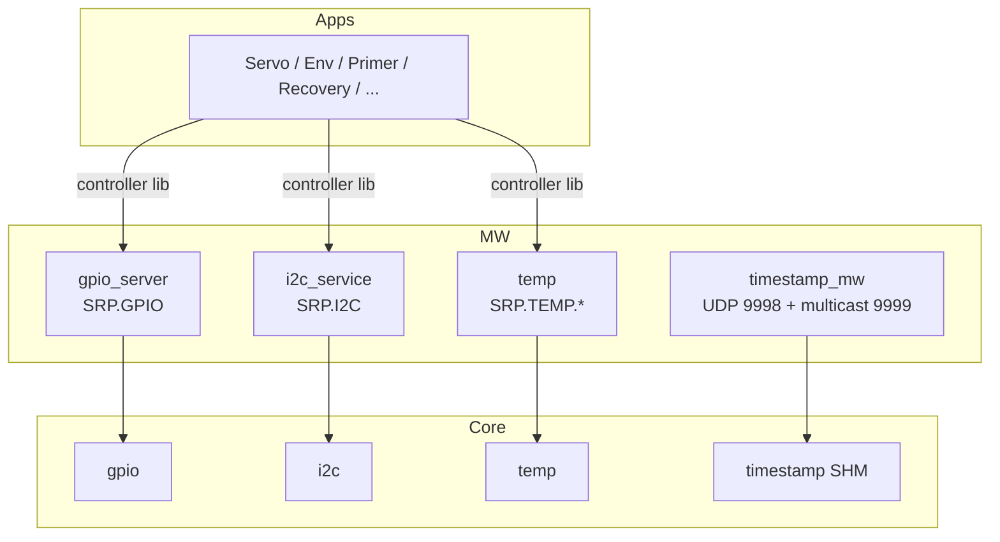
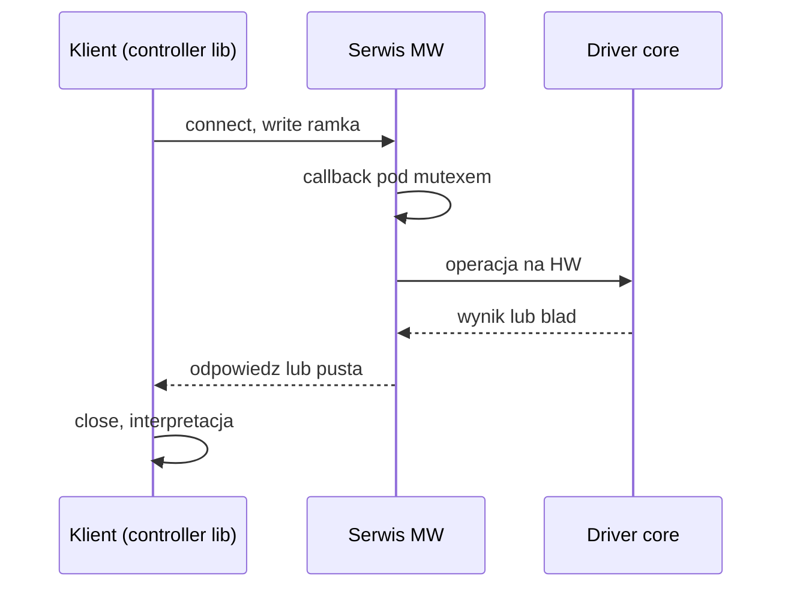

# Middleware (mw)

Warstwa Adaptive Applications między sterownikami `core` a aplikacjami `apps`. **Nie wystawia SOME/IP** — komunikacja to Unix IPC (GPIO / I2C / temp) albo UDP + multicast (timestamp / tinyNTP).

## TL;DR

Cztery usługi HW na każdym CPU (EC, FC, SEC_EC): GPIO, I2C, 1-Wire temp, synchronizacja czasu. Aplikacje linkują biblioteki *controller* i wołają MW przez gniazda IPC.

## Architektura

## Usługi

| Usługa | Endpoint | Rola |
|--------|----------|------|
| [gpio_server](gpio_server/README.md) | `SRP.GPIO` | Cyfrowe piny, timer auto-off, subskrypcje |
| [i2c_service](i2c_service/README.md) | `SRP.I2C` | Wyłączny dostęp do magistrali + kontrolery chipów |
| [temp](temp/README.md) | `SRP.TEMP.SERVICE` | 1-Wire, periodyczny push do subskrybentów |
| [timestamp_mw](timestamp_mw/README.md) | UDP 9998 + multicast 231.255.42.99:9999 | tinyNTP, korekta SHM |

Diagnoza UDS: GPIO DID 12, temp DID 13. I2C ma zdefiniowane DID, ale nie są podpięte do serwisu.

## Wspólny mechanizm IPC

GPIO, I2C i temp używają `StreamIpcSocket` / `IpcSocket` (`communication-core/sockets`):

- Endpoint to gniazdo `AF_UNIX` `/run/<nazwa>` (np. `/run/SRP.I2C`), tworzone przez serwis w `Initialize` (`bind` + `listen`).
- Klient (`GPIOController`, `I2CController`, `TempController`) przy **każdym** żądaniu otwiera nowe połączenie: `connect` → `write` → `read` (limit odpowiedzi 512 B, timeout odczytu **2 s**) → `close`.
- Serwer obsługuje połączenia sekwencyjnie w jednym wątku RX (`accept` → `read` do 4096 B → callback → `write` odpowiedzi, o ile niepusta → `close`). Pusta odpowiedź = klient czyta 0 B.
- Brak serwisu (brak pliku gniazda) → klient dostaje `nullopt` (`kConnectionError` w `Set/Write`). Brak odpowiedzi w 2 s → `nullopt`.

## Cykl życia i zależności startu

Wszystkie cztery aplikacje wchodzą w grupy funkcjonalne `MW`, `Running`, `SafetyMode` (timestamp dodatkowo `Platform`). Aplikacje użytkowe nie czekają w kodzie na MW — polegają na kolejności startu grup i ponawiają tylko tam, gdzie to zakodowano (np. `env_service` próbuje zainicjalizować `TempController` do 6 razy co 500 ms).

| Usługa | Błąd `Initialize` | Skutek |
|--------|--------------------|--------|
| gpio_server | brak/uszkodzony `etc/config.json` | `exit(1)` |
| gpio_server | bind gniazda | `kInitializeError` |
| i2c_service | otwarcie `/dev/i2c-2` lub bind | `kInitializeError` |
| temp | bind `SRP.TEMP.SERVICE` | kod błędu, usługa nie startuje |
| timestamp_mw | brak `ntp_config.json` | −1; błąd bindu UDP/multicast tylko logowany |

## Obsługa błędów — konwencja odpowiedzi

| Usługa | Sukces | Błąd po stronie sprzętu | Błąd transportu |
|--------|--------|--------------------------|-----------------|
| GPIO `SET` | `{0}` (`kOk`) | `{kError}` | `kConnectionError` |
| I2C zapis | `{1}` | pusta odpowiedź | `kConnectionError` |
| I2C odczyt | bajty | pusta odpowiedź (`optional` z pustym wektorem) | `nullopt` |
| temp | `sensor_id` przy subskrypcji, push `TempReadHdr` | czujnik pomijany w cyklu | `nullopt` |

Kontrolery po stronie aplikacji muszą więc sprawdzać zarówno `has_value()`, jak i rozmiar odpowiedzi.

## Testy

- GPIO: `//mw/gpio_server/tests:{data_structure_test,gpio_controller_test,gpio_service_test}`.
- I2C: `//mw/i2c_service/tests:{data_structure,i2c_controller_test,ads7828_test,adcsensor_test}`.
- Temp: brak aktywnych UT (`mw/temp/tests/BUILD` zakomentowany).
- Timestamp: `//mw/timestamp_mw/ntp/ut:{controller_test,discovery_manager_test,config_manager_test}`.
