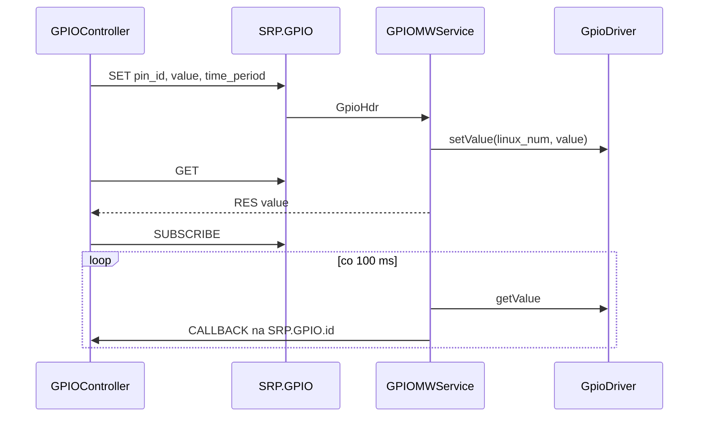
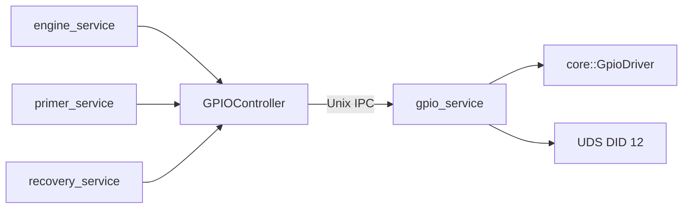
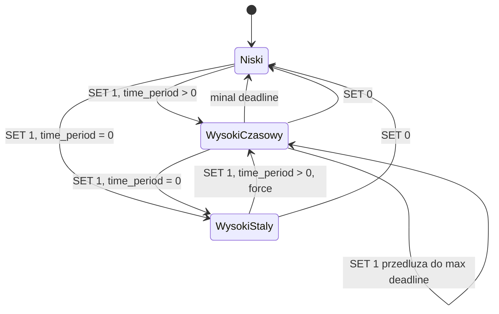

# gpio_server (mw)

Middleware serializujące dostęp do pinów cyfrowych.

## TL;DR

Aplikacje wołają `GPIOController` (IPC `SRP.GPIO`). Serwis mapuje logiczne `pin_id` na numery Linux GPIO, obsługuje impuls czasowy (auto-off) i powiadomienia o zmianie stanu. PWM nie jest wspierane — do serw używaj PCA9685 (`i2c_service`).

## Opis funkcjonalności

- **SET** — zapis 0/1 (tylko piny z `direction: out`, inaczej błąd). `time_period > 0` → automatyczny powrót do 0 po ms; `time_period == 0` → zostaje; `force_time_period` kasuje tryb „zostań HIGH”.
- **GET** — odczyt aktualnej wartości.
- **SUBSCRIBE / UNSUBSCRIBE** — polling co 100 ms, callback na `SRP.GPIO.<controller_id>`; w SUBSCRIBE pole `value` = `controller_id` (0 → serwis nadaje nowe ID i zwraca je w odpowiedzi).
- Wątek wygaszania pinów: sen do najbliższego deadline (min. 5 ms).
- Heartbeat pinów w aplikacjach (engine pin 1, radio i logger pin 2, primer pin 3, servo pin 4) idzie tędy.

## Architektura





## Cykl życia

1. `Initialize`: tworzy `StreamIpcSocket` i `GpioDriver`; bind `/run/SRP.GPIO` (błąd → `kInitializeError`); rejestruje `RxCallback`; wczytuje `app_path + "etc/config.json"` (**brak/uszkodzony plik lub brak tablicy `gpio` → `exit(1)`**; brak parametru `app_path` → wyjątek `std::map::at`); `InitPins` eksportuje i konfiguruje każdy pin z configu (nieudany pin → `Warn`, start trwa).
2. `Run`: startuje wątek wygaszania, oferuje DID, startuje wątek RX gniazda i wchodzi w pętlę pollingu subskrybowanych pinów (100 ms). Odbiór ramek odbywa się w wątku RX gniazda — żądania są obsługiwane sekwencyjnie.
3. Zatrzymanie: `StopRXThread`, `StopOffer` DID.

## Przepływ SET z auto-off



- `SET 1` zapisuje wartość w driverze i wpis w tabeli wygasania: deadline = teraz + `time_period`; kolejny `SET 1` przesuwa deadline do **późniejszego** z dwóch; `time_period == 0` ustawia tryb „stały”, a `force_time_period` z `time_period > 0` zdejmuje go.
- `SET 0` zapisuje 0 w driverze i **nie** usuwa wpisu z tabeli wygasania ani flagi „stały”.
- Wątek wygaszania (`CheckPinsExpired`, sen ≤ 1 s i ≥ 5 ms): po deadline zeruje pin; jeśli w międzyczasie pojawił się nowy wpis (reaktywacja), przywraca 1.

## API IPC

**Endpoint:** `SRP.GPIO`  
**Callback:** `SRP.GPIO.<controller_id>`

| ID | Akcja | Kierunek |
|---:|--------|----------|
| 0 | SET | client → service |
| 1 | GET | client → service |
| 2 | RES | service → client |
| 3 | SUBSCRIBE | client → service |
| 4 | UNSUBSCRIBE | client → service |
| 5 | CALLBACK | service → client |

Ramka `GpioHdr`: `action:u8`, `pin_id:u8`, `value:u8`, `time_period:u16`, `force_time_period:bool`.

Odpowiedzi:

| Akcja | Sukces | Błąd |
|-------|--------|------|
| SET | `{0}` (`kOk`) | `{kError}` dla pinu `in` lub błędu drivera |
| GET | ramka `RES` z wartością | nieznany pin / zły nagłówek: `{0}` |
| SUBSCRIBE | `{controller_id}` | nieznany pin: `{0}` |
| UNSUBSCRIBE | `{1}` | nieznany pin lub ID: `{0}` |

`ErrorCode::kOk` ma wartość 0, więc odpowiedź `{0}` na zły nagłówek lub nieznany `pin_id` jest dla SET odczytywana przez `GPIOController::SetPinValue` jako `kOk`.

### Controller (dla aplikacji)

```cpp
core::ErrorCode SetPinValue(uint8_t actuatorID, int8_t value,
                            uint16_t active_time = 0, bool force_time = false);
std::optional<int8_t> GetPinValue(uint8_t actuatorID);
void SetCallback(std::optional<PinChangeCallback>);  // void(uint8_t pin, uint8_t value)
core::ErrorCode ManagePinSubscription(uint8_t pin_id, bool subscribe);
```

Zachowanie klienta: brak gniazda → `kInitializeError`; błąd transportu (serwis nie działa, timeout 2 s) → `kConnectionError`; pusta odpowiedź → `kConnectionError`; `GetPinValue` zwraca `nullopt` przy błędzie transportu lub niepoprawnej ramce `RES`. `ManagePinSubscription` jest idempotentne po stronie klienta.

## Obsługa błędów

| Sytuacja | Zachowanie |
|----------|------------|
| ramka krótsza niż nagłówek | `Warn`, odpowiedź `{0}` |
| nieznany `pin_id` | `Warn`, odpowiedź `{0}` |
| SET na pinie `in` | `Warn`, `{kError}` |
| `setValue` zwraca błąd | `LogError`, `{kError}`, wpis wygasania nie jest tworzony |
| auto-off nieudany | `Warn`, wpis i tak usunięty (brak ponowienia) |
| callback do subskrybenta nieudany | `Warn`, bez usuwania subskrypcji |
| nieznana akcja | `Warn`, pusta odpowiedź |

## Konfiguracja

`deployment/mw/gpio/config.json` (instalowane jako `etc/config.json`):

```json
{ "gpio": [ { "id": 1, "num": 533, "direction": "out", "desc": "..." } ] }
```

| Pole | Typ | Opis |
|------|-----|------|
| `id` | uint8 | logiczny `pin_id` używany przez aplikacje |
| `num` | uint16 | numer Linux GPIO (sysfs) |
| `direction` | string | `"out"`; każda inna wartość = wejście |

Wpis bez któregoś pola jest pomijany; powtórzony `id` — zostaje pierwszy. Piny 1–17 (BeagleBone, m.in. LED L0–L3, P8_x). Stałe: polling 100 ms, minimalny sen wątku wygaszania 5 ms.

## Diagnostyka

| Pole | Wartość |
|------|---------|
| DID | `gpio_pin_did` → `/srp/mw/gpio_service/gpio_pin_did` |
| `sub_service_id` | 12 |
| Read 0x22 | 4-bajtowy bitset: bit `pin_id` = poziom (odczyt na żywo z drivera, little-endian: bajt 0 = piny 0–7) |
| Write | 2 B: `[pin_id, 0\|1]`, `pin_id ≤ 60`; zły rozmiar → `kInvalidMessageLengthFormat`, zły zakres → `kInvalidKey` |

## Zależności

`//core/gpio:gpio_drivers` (lub sim), `//core/file:file_lib`, `StreamIpcSocket`.

## BUILD

| Target | Rodzaj |
|--------|--------|
| `//mw/gpio_server:gpio_service` | binary |
| `//mw/gpio_server:gpio_service_lib` | lib |
| `//mw/gpio_server/controller:gpio_controller` | klient |
| `//deployment/mw/gpio:gpio_service` | adaptive_application |

Testy: `bazel test //mw/gpio_server/tests:data_structure_test //mw/gpio_server/tests:gpio_controller_test //mw/gpio_server/tests:gpio_service_test`.
