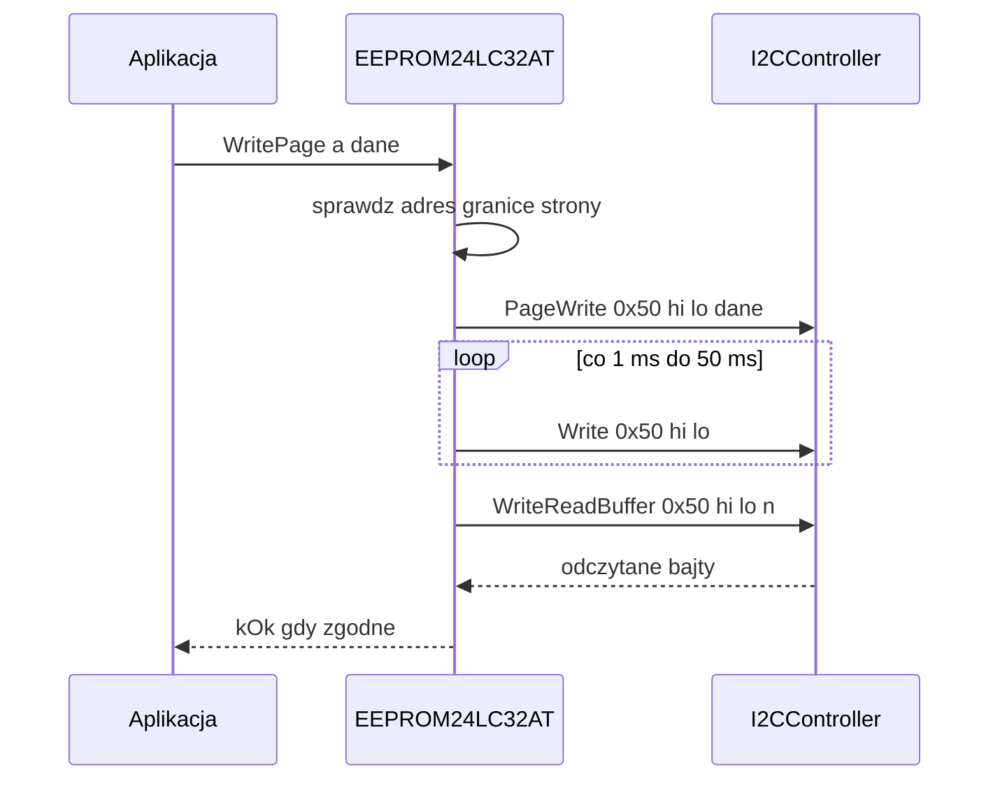

# 24LC32AT (EEPROM 4 KB) i ConfigManager

## TL;DR

`EEPROM24LC32AT` zapisuje i czyta pamięć 24LC32AT (domyślnie adres `0x50`, 4096 B, strony po 32 B) z weryfikacją zapisu odczytem zwrotnym. `eeprom_config/ConfigManager` trzyma na jej początku 43-bajtową konfigurację płyty (korekta PCA9685 + ID trzech czujników DS18B20). Korzystają z niej `ServoService`, `env_service` (EC, FC) i sec_ec `env_service`.

## Opis funkcjonalności

| Metoda | Zachowanie |
|--------|------------|
| `Init(i2c)` | przypisuje kontroler, `i2c->Init(StreamIpcSocket)` (wynik ignorowany), próbny odczyt adresu 0 |
| `WriteByte(a, d)` | 1 B, odczyt zwrotny |
| `WritePage(a, v)` | do 32 B w obrębie jednej strony, odczyt zwrotny |
| `WriteBuffer(a, v)` | dowolna długość, dzielona na kawałki po granicach stron 32 B (kolejne `WritePage`) |
| `ReadByte(a)` / `ReadSequential(a, n)` | `n` ≤ 255 B, jedna transakcja |
| `ReadBuffer(a, n)` | dowolna długość, kawałki po 128 B |

## Protokół

- Adres komórki: 12 bitów w dwóch bajtach `{(a>>8)&0x0F, a&0xFF}`; poprawne `a ≤ 0x0FFF` (inaczej `kError` / `nullopt`).
- Odczyt: `WriteReadBuffer(addr, {hi, lo}, n)` — jedna transakcja `I2C_RDWR` z repeated START.
- Zapis strony: `PageWrite(addr, {hi, lo, dane...})` (jeden `write()`); zapis bajtu: `Write(addr, {hi, lo, dane})`.
- Cykl zapisu: `WaitForWriteCycle` próbuje co **1 ms** przez maks. **50 ms** zapisać 2 bajty adresu (chip odpowiada ACK dopiero po zakończeniu zapisu). Po przekroczeniu — log `Warn` i stałe 5 ms, a funkcja i tak zwraca `kOk`.

## ConfigManager

Układ pod adresem `0x0000` (`[[gnu::packed]]`, `static_assert` = 43 B):

| Offset | Pole | Typ | Domyślnie |
|--------|------|-----|-----------|
| 0 | `pca9685_XO_corelation` | `float` | 1,0 (wartość inicjalna struktury; po odczycie liczy się zawartość EEPROM) |
| 4 | `board_temp1_id` | `char[13]` | — |
| 17 | `board_temp2_id` | `char[13]` | — |
| 30 | `board_temp3_id` | `char[13]` | — |

`SetConfig` zapisuje 43 B jako dwa kawałki (32 B + 11 B, granica strony przy 0x20). `GetConfig` czyta 43 B jednym kawałkiem i zwraca `nullopt` przy niepełnych danych; zawartości nie waliduje (pusty/skasowany EEPROM = bajty `0xFF`, co daje `float` NaN).

## Obsługa błędów

| Sytuacja | Wynik |
|----------|-------|
| adres > 0x0FFF, pusty bufor, zapis przekraczający stronę (`WritePage`) lub pamięć | `kError`, bez I2C |
| `PageWrite`/`Write` nieudany | `kConnectionError` |
| odczyt zwrotny nieudany / pusty | `kConnectionError` (zapis mógł się udać) |
| odczyt zwrotny ≠ zapisany | `kError` |
| `ReadBuffer` — kawałek nieudany lub krótszy | `std::nullopt` |
| `Init` — próbny odczyt 0x0000 nieudany | `kInitializeError` |

Reakcje aplikacji: `ServoDriver::Init` kończy proces (`exit(1)`) gdy `GetConfig` nie zwróci danych; `env_service` zgłasza błąd inicjalizacji (`LogError`) i nie startuje.

Ograniczenie: `WriteByte` wysyła 3 bajty `{hi, lo, dane}` przez `kWrite`, a `I2CDriver::Write(vector)` przyjmuje parzystą liczbę bajtów (pary), więc przy realnym serwisie ta ścieżka jest odrzucana; `ConfigManager` używa `WriteBuffer`→`PageWrite` i nie jest tym dotknięty.

## Zależności

`//mw/i2c_service/controller:i2c_controller`; `eeprom_config` zależy od `24lc32at:controller`.

## Testy

Brak UT dla EEPROM/ConfigManager.

## BUILD

`//mw/i2c_service/controller/24lc32at:controller`, `//mw/i2c_service/controller/24lc32at/eeprom_config:eeprom_config`.
