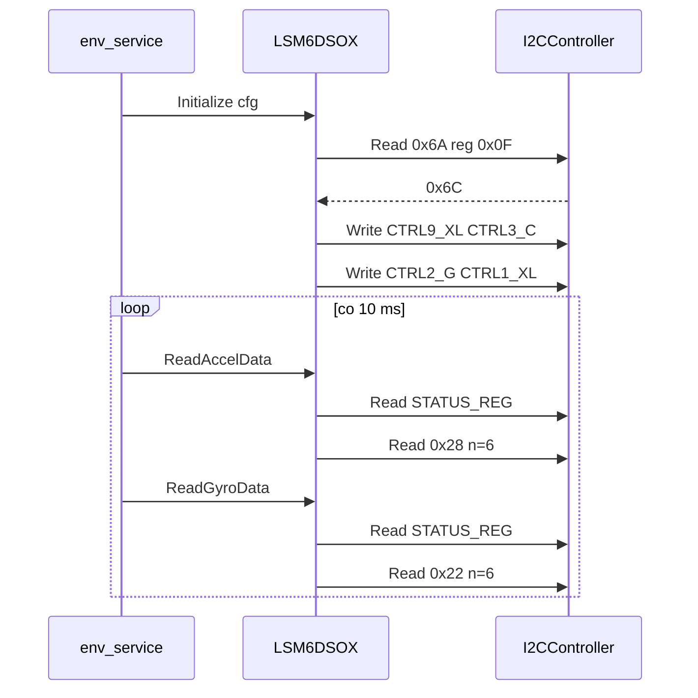

# LSM6DSOX (IMU: akcelerometr + żyroskop)

## TL;DR

`LSM6DSOX` inicjalizuje IMU (adres `0x6A`, WHO_AM_I `0x6C`) i zwraca przyspieszenie w **g** oraz prędkość kątową w **°/s**. Używany przez `apps/fc/env_service` (akcelerometr ±16 g i żyroskop ±2000 °/s, oba 208 Hz), odczyt co 10 ms.

## Opis funkcjonalności

- `Initialize(i2c, config_t)` — `config_t` = `{accel_speed, accel_scale, gyro_speed, gyro_scale}` (enumy w `consts.hpp`: ODR 12,5 Hz … 6,66 kHz; zakresy ±2/4/8/16 g oraz ±250/500/1000/2000 °/s).
- `ReadAccelData()` / `ReadGyroData()` → `SensorData{x, y, z}` (`float`).

## Rejestry i sekwencja init

| Krok | Operacja | Wartość |
|------|----------|---------|
| 1 | `i2c->Init(StreamIpcSocket)` | — |
| 2 | odczyt `WHO_AM_I` (0x0F) | oczekiwane `0x6C` |
| 3 | zapis `CTRL9_XL` (0x18) | `0xE2` (DEN_XYZ, I3C wyłączone) |
| 4 | zapis `CTRL3_C` (0x12) | `0x44` (BDU + IF_INC) |
| 5 | zapis `CTRL2_G` (0x11) | `gyro_speed \| gyro_scale` |
| 6 | zapis `CTRL1_XL` (0x10) | `accel_speed \| accel_scale` |

`BDU` blokuje aktualizację starszego/młodszego bajtu do czasu odczytu obu; `IF_INC` włącza autoinkrementację adresu przy odczycie 6 B.

## Konwersje

Surowe wartości: `int16` little-endian (`lo | hi<<8`), osie X, Y, Z po 2 B od `OUTX_L_G` (0x22) / `OUTX_L_XL` (0x28).

| Zakres | Czułość (stała) | Wzór |
|--------|-----------------|------|
| ±2 / 4 / 8 / 16 g | 61 / 122 / 244 / 488 (0,061 … 0,488 mg/LSB ×1000) | `g = raw · S / 1 000 000` |
| ±250 / 500 / 1000 / 2000 °/s | 875 / 1750 / 3500 / 7000 (8,75 … 70 mdps/LSB ×100) | `°/s = raw · S / 100 000` |

Odczyt jest wykonywany tylko, gdy `STATUS_REG` (0x1E) zgłasza nowe dane: bit 0 (XLDA) dla akcelerometru, bit 1 (GDA) dla żyroskopu.

## Obsługa błędów

| Sytuacja | Wynik |
|----------|-------|
| `Init` socketu nieudany | `kInitializeError` |
| `WHO_AM_I` nieodczytany, pusty lub ≠ `0x6C` | `kInitializeError` (log `Error`) |
| zapis `CTRL9_XL` lub `CTRL3_C` nieudany | `kInitializeError`, dalsze kroki pomijane |
| zapis konfiguracji żyroskopu lub akcelerometru nieudany | próbowane są oba, wynik `kInitializeError` |
| `STATUS_REG` nieodczytany, pusty lub bit danych = 0 | `std::nullopt` (brak nowej próbki to nie błąd) |
| odczyt 6 B nieudany lub krótszy | `std::nullopt` |

W `env_service` nieudany `Initialize` nie zatrzymuje aplikacji: `imu_ready_ = false`, log `Warn` i brak wątku IMU. W wątku IMU pętla pomija iterację, jeśli brakuje którejkolwiek z próbek (accel lub gyro).

## Zależności

`//mw/i2c_service/controller:i2c_controller`. Dokumentacja chipa: `lsm6dso.pdf` w katalogu.

## Testy

Brak UT.

## BUILD

`//mw/i2c_service/controller/LSM6DSOX:LSM6DSOX_controller`.
