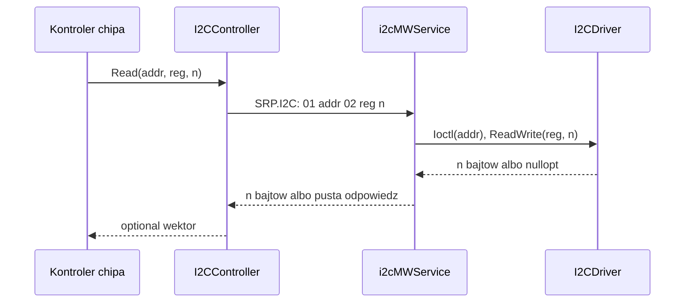

# i2c_controller (klient `SRP.I2C`)

## TL;DR

`I2CController` to cienki klient IPC: pakuje żądanie w ramkę `action | address | payload_size | payload`, wysyła je gniazdem `SRP.I2C` do `i2cMWService` i zwraca surową odpowiedź. Nie zna żadnego chipa — chipy (`ina219`, `ads7828`, `pca9685`, `24lc32at`, `bme280`, `LSM6DSOX`, `adcsensor`) trzymają wskaźnik `II2CController` i budują na nim własne sekwencje rejestrów.

## Opis funkcjonalności

- `II2CController` (`Ii2c_controller.h`) — interfejs: `Init`, `Write`, `PageWrite`, `Read`, `WriteRead`, `WriteReadBuffer`. Interfejs pozwala podmienić transport w testach (`mock/mock_i2ccontroller.h`).
- `I2CController` (`i2c_controller.{h,cpp}`) — implementacja przez `StreamIpcSocket`.
- Każde wywołanie to osobne połączenie `AF_UNIX` do `/run/SRP.I2C`: connect → write → read (timeout odczytu 2 s) → close. Serwis obsługuje połączenia jedno po drugim, więc wszyscy klienci szeregują się na jednym mutexie/pętli serwisu.

## Architektura

## API

| Metoda | Akcja | Payload wysyłany | Odpowiedź serwisu |
|--------|-------|------------------|-------------------|
| `Write(addr, data)` | `kWrite` 0x02 | `data` | `{1}` = OK, pusta = błąd |
| `PageWrite(addr, data)` | `kPageWrite` 0x05 | `data` (jeden `write()` całości) | `{1}` / pusta |
| `Read(addr, reg, n)` | `kRead` 0x01 | `{reg, n}` | `n` bajtów / pusta |
| `WriteRead(addr, b, n)` | `kWriteRead` 0x03 | `{n, b}` | `n` bajtów / pusta (dwie osobne transakcje: write 1 B, read n) |
| `WriteReadBuffer(addr, w, n)` | `kWriteReadBuffer` 0x06 | `{n, w...}` | `n` bajtów / pusta (jedna transakcja `I2C_RDWR`, repeated START) |

Ograniczenia wynikające z kodu serwisu/drivera:

- `Write`: serwis przyjmuje 1 bajt albo parzystą liczbę bajtów — driver zapisuje je jako pary `{rejestr, wartość}`, każda parą osobnym `write()`. Zapis o nieparzystej długości >1 jest odrzucany po stronie drivera.
- Odpowiedź w IPC ma bufor 512 B; `n` jest `uint8_t` (max 255).

## Obsługa błędów

Rozróżnij dwa przypadki:

| Sytuacja | `Write`/`PageWrite` | `Read`/`WriteRead*` |
|----------|--------------------|---------------------|
| Serwis nie działa / timeout 2 s / brak `Init` | `kConnectionError` | `std::nullopt` |
| Chip nie odpowiada (NACK), błąd drivera, zły payload | `kConnectionError` (odpowiedź pusta) | `optional` z **pustym** wektorem (`has_value()==true`) |

Dlatego kontrolery chipów sprawdzają `has_value()` **i** rozmiar odpowiedzi (np. INA219 `size() < 2`, BME280 `size() != 24`). `Init(nullptr)` zwraca `kInitializeError`; `SendData` bez `Init` loguje błąd i zwraca `nullopt`.

## Cykl życia

1. Aplikacja tworzy `I2CController` i woła `Init(std::make_unique<StreamIpcSocket>())` (domyślny argument robi to samo).
2. Chipy `pca9685`, `24lc32at`, `bme280`, `LSM6DSOX` wołają `Init` na przekazanym kontrolerze same; `ads7828` **nie** — aplikacje (env_service, primer) inicjalizują `I2CController` przed `ADS7828::Init`.
3. Brak wątków i zamykania — gniazdo klienta jest tworzone per wywołanie.

## Mock i testy

- `mock/mock_i2ccontroller.h` — `MockI2CController` (gmock) i `mock/mock_ads7828.h` — `MockADS7828` (cele `//mw/i2c_service/controller/mock:mock_i2c_controller`, `:mock_ads7828`).
- UT: `bazel test //mw/i2c_service/tests:i2c_controller_test //mw/i2c_service/tests:ads7828_test //mw/i2c_service/tests:adcsensor_test //mw/i2c_service/tests:data_structure`. Test PCA9685 jest w `tests/BUILD` zakomentowany.

## Zależności

`//core/i2c:i2cdriver`, `//communication-core/sockets:socket_ipc`, `//mw/i2c_service/data:{i2c_hdr,i2c_factory}`. Szczegóły serwisu: [`../README.md`](../README.md).

## BUILD

`//mw/i2c_service/controller:i2c_controller` (widoczność: `//apps`, `controller/*`, `tests`).
