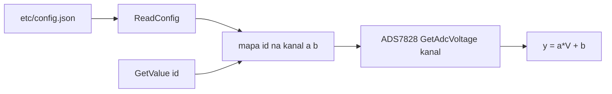

# ADCSensorController (czujniki analogowe na ADS7828)

## TL;DR

`ADCSensorController` mapuje `sensor_id` na kanał ADS7828 i liniową funkcję `y = a·V + b` (V w woltach z ADC, y w jednostce docelowej, np. bar). Konfiguracja z `<app_path>etc/config.json`. Używany przez `env_service` (EC) i sec_ec `env_service` do czujników ciśnienia.

## Opis funkcjonalności

- `Init(path, adc)` — zapisuje wskaźnik `IADS7828`, wczytuje `path + "etc/config.json"` (konkatenacja bez separatora), loguje każdy zarejestrowany czujnik (`y = a * V ± |b|`).
- `GetValue(id)` → `a·V + b` albo `nullopt`.
- `MakeCalibration(id)` — ustawia w pamięci `a = (1 − b) / V` dla bieżącego napięcia (czujnik ma dać 1,0); nie zapisuje do pliku.

## Konfiguracja

Plik JSON: tablica `sensors`. Każdy wpis:

| Pole | Typ | Jednostka | Wymagane | Opis |
|------|-----|-----------|----------|------|
| `sensor_id` | uint8 | — | tak | klucz w `GetValue` |
| `channel` | uint8 | — | tak | kanał ADS7828 0–7 (nie walidowany przy wczytaniu) |
| `a`, `b` | float | jedn./V, jedn. | para `a`+`b` **albo** model niżej | współczynniki wprost |
| `R` | float | Ω | model rezystancyjny | rezystor pomiarowy pętli prądowej |
| `RES_MIN`, `RES_MAX` | float | jedn. docelowa | j.w. | zakres czujnika |
| `A_MIN`, `A_MAX` | float | mA | j.w. | prąd czujnika (np. 4 / 20) |

Model rezystancyjny (`I = V/R`, y liniowe względem prądu):

```
a = (RES_MAX - RES_MIN) * 1000 / ((A_MAX - A_MIN) * R)
b = RES_MIN - (A_MIN / 1000) * R * a
```

Wpis bez kompletu pól jest pomijany bez logu; przy powtórzonym `sensor_id` zostaje pierwszy wpis (`insert`). Para `a`+`b` ma pierwszeństwo przed modelem. `MakeCalibration` zwraca `nullopt`, gdy odczyt napięcia wynosi 0 lub nie jest liczbą skończoną (wcześniej dzielenie przez 0).



## Obsługa błędów

| Sytuacja | Wynik |
|----------|-------|
| `Init` z `adc == nullptr` | `kInitializeError` |
| brak/nieczytelny plik | `kNotDefine` (wskaźnik ADC już zapisany) |
| brak tablicy `sensors` | log `Error`, pusta baza, `Init` zwraca `kOk` |
| `GetValue`/`MakeCalibration`: brak ADC, nieznany `sensor_id` lub `GetAdcVoltage` = `nullopt` | `std::nullopt` |

Aplikacje traktują `kNotDefine` jako błąd inicjalizacji (`env_service` zwraca `kInitializeError`); `nullopt` z `GetValue` w pętli pomiarowej oznacza pominięcie próbki.

## Zależności

`//mw/i2c_service/controller/ads7828:adc_controller`, `//core/json:simba_json`.

## Testy

`bazel test //mw/i2c_service/tests:adcsensor_test` — wzory `CalculateA/B`, `ReadConfig` (zestaw `tests/test_adcsensor/t_*.json`), `GetValue`, `Init` z `nullptr`.

## BUILD

`//mw/i2c_service/controller/adcsensor:adc_sensor_controller`.
