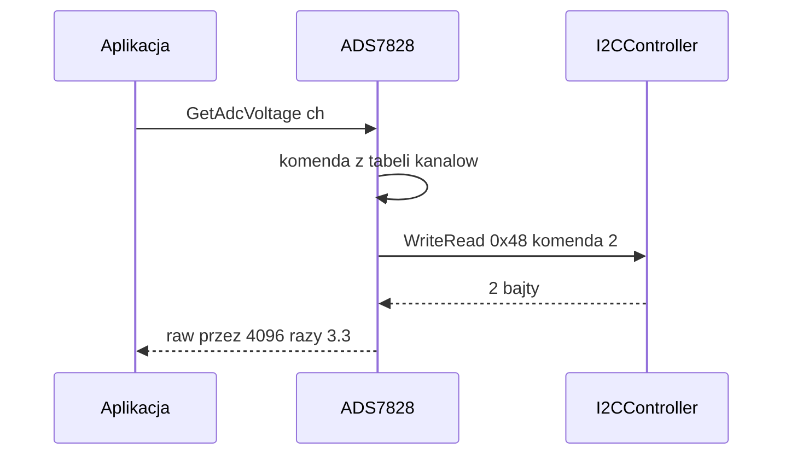

# ADS7828 (12-bitowy ADC, 8 kanałów)

## TL;DR

`ADS7828` czyta jeden kanał ADC (adres I2C `0x48`, tryb single-ended, 12 bit) i przelicza wynik na napięcie z referencją 3,3 V. Używany przez `env_service` (EC i sec_ec — przez `ADCSensorController`) oraz `primer_service` (kanał 3, pomiar zapłonnika).

## Opis funkcjonalności

- `GetAdcRawRead(ch)` → `0..4095`.
- `GetAdcVoltage(ch)` → `raw / 4096 · 3,3` V.
- Interfejs `IADS7828` (`Iads7828.h`) udostępnia publicznie tylko `GetAdcVoltage`; `GetAdcRawRead` i `GetConfigData` są `protected`.

## Protokół

Bajt komendy (`GetConfigData`): `bit7 = 1` (single-ended), `bity 6:4` = kod kanału, `bity 3:0 = 0`. Kod kanału nie jest równy numerowi — tabela `{0, 4, 1, 5, 2, 6, 3, 7}`:

| Kanał | 0 | 1 | 2 | 3 | 4 | 5 | 6 | 7 |
|-------|---|---|---|---|---|---|---|---|
| Komenda | 0x80 | 0xC0 | 0x90 | 0xD0 | 0xA0 | 0xE0 | 0xB0 | 0xF0 |

Odczyt: `I2CController::WriteRead(0x48, komenda, 2)` → serwis wykonuje dwie transakcje (write 1 B, read 2 B). Wynik `raw = (b0 << 8) | b1` (układ zwraca 12 bitów wyrównanych do prawej).

## Obsługa błędów

| Sytuacja | Wynik |
|----------|-------|
| `channel > 7` | `std::nullopt` (bez I2C) |
| brak `Init` / `i2c_ == nullptr` | `std::nullopt` |
| `WriteRead` zwraca `nullopt` (serwis niedostępny) | `std::nullopt` |
| odpowiedź ≠ 2 B (np. pusta po NACK) | `std::nullopt` |
| `Init(nullptr)` | `kInitializeError` |

Brak ponowień i logów — decyzja co zrobić z `nullopt` należy do aplikacji (`ADCSensorController::GetValue` propaguje `nullopt`; `primer_service` traktuje brak napięcia jako brak zmiany stanu).

## Cykl życia

`ADS7828::Init(std::unique_ptr<II2CController>)` tylko zapisuje wskaźnik — **nie** woła `Init` na kontrolerze. Aplikacje robią to przed: `i2c->Init(StreamIpcSocket)` → `adc->Init(std::move(i2c))` (`apps/ec/env_service/env_service.cpp`, `apps/ec/primer_service/controller/primer_controller.cpp`). Domyślny argument `Init()` tworzy `I2CController` bez gniazda — odczyty zwracają wtedy `nullopt`. Chip nie wymaga konfiguracji; każdy odczyt rozpoczyna nową konwersję.

## Zależności

`//mw/i2c_service/controller:i2c_controller`, `//core/json:simba_json`.

## Testy

`bazel test //mw/i2c_service/tests:ads7828_test` — tabela komend (kanały 0–7 i 8), `Init(nullptr)`, raw/napięcie przy zamockowanym `WriteRead`.

## BUILD

`//mw/i2c_service/controller/ads7828:adc_controller` (widoczność: `//apps`, `tests`, `controller`).
