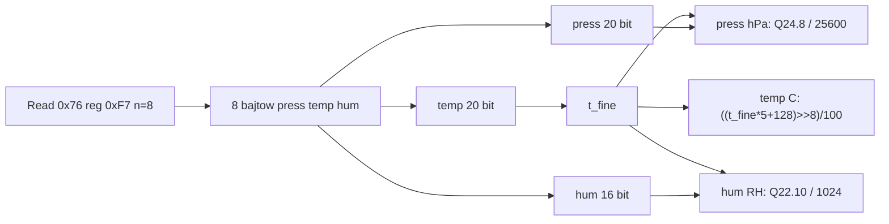

# BME280 (temperatura, ciśnienie, wilgotność)

## TL;DR

`BME280` konfiguruje czujnik (adres `0x76`) w trybie normal i zwraca temperaturę (°C), ciśnienie (**hPa**) i wilgotność (%RH) wg całkowitoliczbowych wzorów kompensacji Bosch. Używany przez `apps/fc/env_service` (pętla 100 ms).

## Opis funkcjonalności

- `Init(i2c)` → konfiguracja + odczyt współczynników kalibracji.
- `getTemperature()`, `getPressure()`, `getHumidity()` — każda funkcja robi **własny** odczyt burst 8 B od `0xF7`; trzy wywołania pod rząd to trzy transakcje i trzy różne próbki.

## Rejestry i konfiguracja

| Rejestr | Adres | Wartość | Znaczenie |
|---------|-------|---------|-----------|
| `ctrl_hum` | 0xF2 | odczyt, `\|= 0x01`, `&= ~0x06` | oversampling wilgotności ×1 |
| `ctrl_meas` | 0xF4 | `0x37` | temp ×1, ciśnienie ×16, tryb normal |
| `config` | 0xF5 | `0x20` | t_standby 62,5 ms, filtr IIR wyłączony |

Kolejność: `ctrl_hum` przed `ctrl_meas` (wymóg układu), potem 10 ms przerwy. Bez sprawdzania ID chipa i bez resetu programowego. Współczynniki: `0x88` ×24 (T1–T3, P1–P9), `0xA1` ×1 (H1), `0xE1` ×8 (H2–H6; H4/H5 składane z `0xE4–0xE6` po 12 bitów).

## Przepływ danych

- Wyodrębnianie pól z 64-bitowego słowa (big-endian): wilgotność bity 15..0, temperatura 39..20, ciśnienie 63..44.
- Temperatura: `T[°C] = ((t_fine·5 + 128) >> 8) / 100`.
- Ciśnienie: wzór 64-bitowy Bosch, wynik w Pa·256, dzielony przez **25600** → hPa.
- Wilgotność: wzór 32-bitowy Bosch, wynik ograniczony do `0…419430400`, dzielony przez 1024 → %RH.
- `t_fine` jest przeliczany w każdej z trzech funkcji z tej samej próbki.

## Obsługa błędów

| Sytuacja | Wynik |
|----------|-------|
| `Init(nullptr)` | `kInitializeError` |
| odczyt `ctrl_hum` nieudany | `kError` → `Init` zwraca `kInitializeError` |
| zapis `ctrl_hum`/`ctrl_meas`/`config` nieudany | `kInitializeError` |
| któryś z 3 odczytów kalibracji ma zły rozmiar (24/1/8 B) | `kError` → `Init` zwraca `kInitializeError` |
| odczyt wyników nieudany lub ≠ 8 B | `std::nullopt` (log `Debug`) |
| ciśnienie: `var1 == 0` (zerowe `dig_P1`) | `std::nullopt` |

W `env_service` brak jednego z trzech wyników pomija publikację zdarzenia (`"dont receive new data"`, `Warn`); błąd `Init` kończy inicjalizację aplikacji (`kInitializeError`). Brak ponowień na poziomie kontrolera.

## Zależności

`//mw/i2c_service/controller:i2c_controller`, `//core/common` (`condition`).

## Testy

Brak UT.

## BUILD

`//mw/i2c_service/controller/bme280:bme280_controller`.
