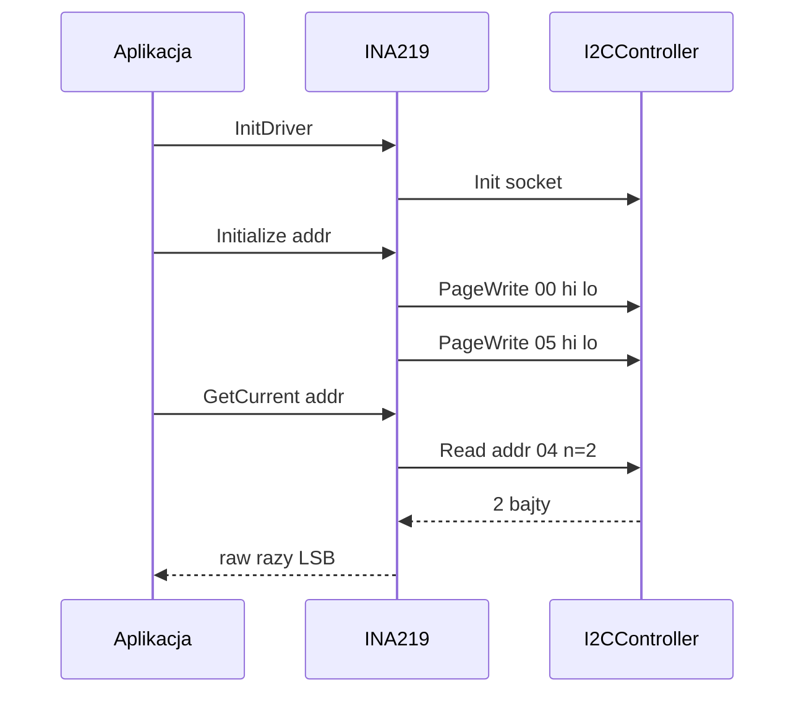

# INA219 (pomiar prądu i napięcia szyny)

## TL;DR

`INA219` konfiguruje monitor mocy INA219 (adres podawany przez wywołującego) i odczytuje prąd (A) oraz napięcie szyny (V). Kalibracja stała: shunt 0,01 Ω, zakres do 8 A. W repo kontroler jest linkowany przez `ServoService/servoController` (pole `ina219_address` w configu), ale żaden kod aplikacji go jeszcze nie wywołuje.

## Opis funkcjonalności

- `InitDriver()` — `I2CController::Init` z `StreamIpcSocket`.
- `Initialize(addr)` — zapis rejestru konfiguracji i kalibracji.
- `GetCurrent(addr)` — `float` w amperach; `GetVoltage(addr)` — `float` w woltach.

## Rejestry i konwersje

| Rejestr | Adres | Wartość / użycie |
|---------|-------|------------------|
| Configuration | 0x00 | `0x0C47` = BRNG 16 V, PGA /2 (±80 mV), BADC=SADC=`0b1000`, tryb 0b111 (shunt+bus, ciągły) |
| Shunt voltage | 0x01 | nieużywany |
| Bus voltage | 0x02 | odczyt 2 B |
| Power | 0x03 | nieużywany |
| Current | 0x04 | odczyt 2 B |
| Calibration | 0x05 | `trunc(0.04096 / (LSB·R))` = **16777** (0x4189) |

- `Current_LSB = 8 A / 32768 = 244,14 µA`; `R_shunt = 0,01 Ω` (stałe w kodzie, nie w configu).
- Prąd: `int16_t raw = (b0<<8)|b1; I[A] = raw · Current_LSB` (ze znakiem).
- Napięcie: `raw16 = (b0<<8)|b1; V = (raw16 >> 3) · 0,004` (LSB 4 mV; bity statusu CNVR/OVF są odrzucane, nie sprawdzane).
- Pole ADC `0b1000` = 12 bitów, 1 próbka (komentarz w kodzie mówił „2 samples” — poprawiony).

## Obsługa błędów

| Sytuacja | Efekt |
|----------|-------|
| `Init` socketu nieudany | `InitDriver` → `kInitializeError` |
| `PageWrite` konfiguracji lub kalibracji nieudany | `Initialize` → `kConnectionError` (log `Error`), bez ponowień |
| `Read` zwróci `nullopt` lub <2 B | `GetCurrent`/`GetVoltage` → `std::nullopt` |

Oba zapisy rejestrów to ramki 3-bajtowe `{reg, hi, lo}` wysyłane jako `PageWrite` (jeden `write()`): zwykły `Write` przyjmuje tylko pary `reg,val` (parzystą liczbę bajtów), więc 3-bajtowa ramka była odrzucana i `Initialize` zawsze zwracał `kConnectionError`.

## Zależności

`//mw/i2c_service/controller:i2c_controller`, `//core/json:simba_json`. Użytkownik: `apps/ec/ServoService/servoController` (tylko dependency).

## BUILD

`//mw/i2c_service/controller/ina219:ina219_controller` (public). Brak UT.
