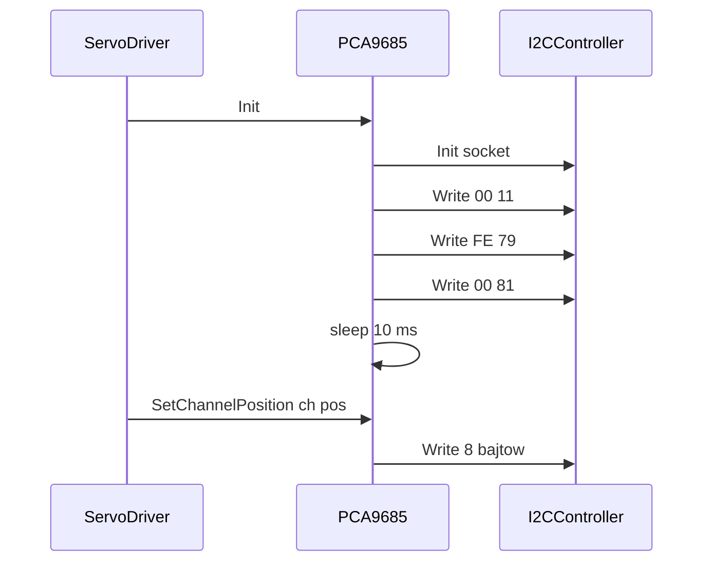

# PCA9685 (16-kanałowy PWM, serwa)

## TL;DR

`PCA9685` ustawia układ (adres `0x70`) na PWM 50 Hz i pozwala ustawić/odczytać pozycję kanału w tickach (0–4095, 1 tick ≈ 4,88 µs). Używany wyłącznie przez `ServoService` (`ServoDriver`), który przelicza kąt → ticki.

## Opis funkcjonalności

- `Init(i2c)` — przypisuje kontroler, woła na nim `Init(StreamIpcSocket)` (kod zwrotu ignorowany), konfiguruje chip.
- `SetChannelPosition(ch, pos)` — jeden zapis 8 B: `ON = 0`, `OFF = pos`.
- `ReadChannelPosition(ch)` — odczyt 4 B od `LEDn_ON_L`, zwraca `OFF`.

## Rejestry i sekwencja init

| Krok | Zapis `{rejestr, wartość}` | Znaczenie |
|------|---------------------------|-----------|
| 1 | `{0x00, 0x11}` | MODE1: SLEEP + ALLCALL (preskaler zapisywalny tylko w uśpieniu) |
| 2 | `{0xFE, 0x79}` | PRE_SCALE = 121 → `25 MHz / (4096·(121+1)) ≈ 50 Hz` |
| 3 | `{0x00, 0x81}` | MODE1: RESTART + ALLCALL |
| 4 | — | `sleep_for(10 ms)` (stabilizacja oscylatora) |

Rejestry kanału `n` (0–15) z tablic: `ON_L = 0x06+4n`, `ON_H = 0x07+4n`, `OFF_L = 0x08+4n`, `OFF_H = 0x09+4n`. `SetChannelPosition` wysyła `{ON_L,0, ON_H,0, OFF_L,pos&0xFF, OFF_H,pos>>8}` (4 pary — zgodnie z formatem `kWrite`, który serwis zapisuje parami). Wartość `pos` nie jest maskowana do 12 bitów, a `channel` nie jest sprawdzany względem 16 (tablice mają 16 elementów).

Ticki z poziomu `ServoDriver`: `us = 500 + kąt·2000/180`, `ticki = us·4096/20000` (102…512), a następnie mnożenie przez `pca9685_XO_corelation` z EEPROM ([`24lc32at`](../24lc32at/README.md)).

## Obsługa błędów

| Sytuacja | Wynik |
|----------|-------|
| `Init(nullptr)` | `kInitializeError` |
| któryś z 3 zapisów init nieudany | `kInitializeError` (log `Warn`), bez ponowień; kolejne kroki nie są wykonywane |
| `SetChannelPosition` — `Write` nieudany | zwraca kod z `I2CController::Write` (`kConnectionError`) |
| `ReadChannelPosition` — `Read` zwraca `nullopt` | `std::nullopt` + log `Warn` |

`ReadChannelPosition` sprawdza `has_value()`, ale nie rozmiar odpowiedzi; `ComposePosition` czyta bajty `[2]` i `[3]`, zakładając 4 B. Pustą odpowiedź (NACK) zwraca `I2CController` jako `optional` z pustym wektorem — patrz [`../README.md`](../README.md).

## Zależności

`//mw/i2c_service/controller:i2c_controller`, `//communication-core/sockets:socket_ipc`. Użytkownik: `apps/ec/ServoService/servoController/servo_driver.hpp`.

## Testy

Plik `tests/test_pca9685.cpp` jest w `tests/BUILD` zakomentowany — brak aktywnego UT.

## BUILD

`//mw/i2c_service/controller/pca9685:pca9685_controller`.
