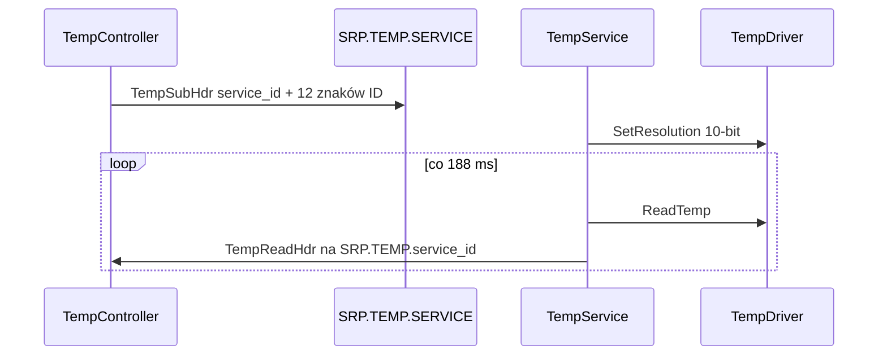
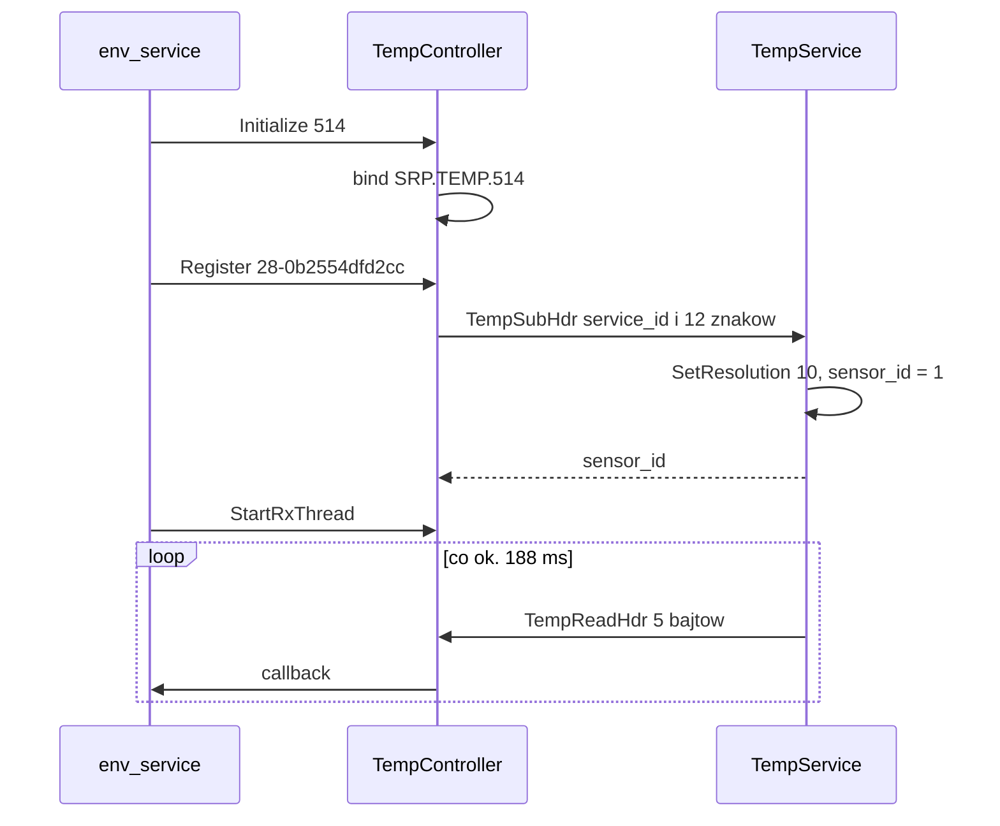

# temp

Middleware czujników 1-Wire (DS18B20).

## TL;DR

Aplikacje subskrybują listę fizycznych ID. Serwis ustawia 10-bit, czyta co 188 ms i pushuje `(sensor_id, float °C)` na `SRP.TEMP.<service_id>`. Wartości są też w DID 13.

## Opis funkcjonalności

1. Bind `SRP.TEMP.SERVICE`, skan czujników, oferta DID.
2. Subscribe: mapowanie `"28-" + 12 znaków` → wewnętrzne `sensor_id` od 1, rozdzielczość 10 bit.
3. Pętla 188 ms (czas konwersji 10-bit): `ReadTemp` async → update DID → `Transmit` do każdego subskrybenta.

Czasy konwersji (`kSensor_resolution`): 9→94 ms, 10→188, 11→375, 12→750.

ID czujników płytki mogą pochodzić z EEPROM (`board_temp{1,2,3}_id`).

## Architektura



## Cykl życia

**Serwis** (`TempService`):

1. `Initialize`: `nextSensorId = 1`; bind `SRP.TEMP.SERVICE` (błąd → zwraca kod błędu, aplikacja nie startuje); start wątku RX; `GetAllAccessibleSensor()` (lista katalogów w `/sys/bus/w1/devices/` poza `w1_bus_master1`) tylko do logu — brak czujników to `Warn`, nie błąd; oferta DID.
2. `Run`: pętla: `wait_for(188 ms)` → migawka zarejestrowanych czujników (pusta lista = kolejny obrót) → dla każdego `std::async` z `ReadTemp` → `future.get()` → `UpdateTemp` w DID + `SendTempReading`. Faktyczny okres to 188 ms + czas najwolniejszego odczytu (sysfs).
3. Zatrzymanie: `StopRXThread`, `StopOffer` DID.

**Klient** (`TempController`, używany przez `env_service` EC/SEC_EC/FC):

1. `Initialize(service_id, callback, sock)` = `Init` (zapis `service_id`, gniazdo subskrypcji) + `SetUp` (bind własnego `SRP.TEMP.<service_id>`, ustawienie callbacku).
2. `Register(physical_id)` na każdy czujnik → `sensor_id` (ponowna rejestracja tego samego czujnika zwraca to samo ID; kolejne `service_id` dopisują się do subskrybentów).
3. `StartRxThread()` — od tego momentu odczyty trafiają do callbacku (`TempRXCallback`).

`env_service` powtarza `Initialize` do 6 razy co 500 ms, bo serwis temp może startować później.

## Przepływ danych

```
/sys/bus/w1/devices/<28-xxxxxxxxxxxx>/temperature   (milistopnie, tekst)
  → TempDriver::ReadTemp:  T [°C] = stod(linia) / 1000.0   (double)
  → TempReadHdr{sensor_id:u8, value:float32 LE}  (5 B)
  → SRP.TEMP.<service_id>  → TempController::Conv (kawałki po 5 B) → callback
  → aplikacja: np. env_service  int16 = (int16)(T · 10)   (°C × 10)
```

Odczyty 85,0 °C i −127,0 °C (wartości po resecie/błędzie DS18B20) są logowane (`Warn`) po stronie drivera, ale zwracane jak poprawne. Rozdzielczość: `ConfigSensor` zapisuje `10` do `<id>/resolution` przy pierwszej rejestracji czujnika.



## API IPC

| Socket | Rola |
|--------|------|
| `SRP.TEMP.SERVICE` | subskrypcja (stream) |
| `SRP.TEMP.<service_id>` | push odczytów |

**TempSubHdr:** `service_id:u16` + `physical_id_1` … `physical_id_12` (uint8) — serwis dokleja prefiks `28-`.  
**TempReadHdr:** `actuator_id:u8`, `value:float32`.

### Controller

```cpp
ErrorCode Initialize(uint16_t service_id, TempRXCallback callback,
                     std::unique_ptr<StreamIpcSocket> sock);
std::optional<uint8_t> Register(std::string name);  // 15-znakowe physical id
void StartRxThread();
// TempRXCallback = void(const std::vector<TempReadHdr>&)
```

Env EC i SEC_EC używają `service_id` 514, env FC — 529.

## Obsługa błędów

| Sytuacja | Zachowanie |
|----------|------------|
| `Initialize` z `sock == nullptr` | `kInitializeError` |
| bind `SRP.TEMP.<service_id>` nieudany | kod błędu z `IpcSocket::Init` |
| `Register` z ID o długości ≠ 15 | `Subscribe` zwraca ramkę z kodem `kError` zamiast `nullopt` (nie sprawdza się dalej długości odpowiedzi) |
| serwis niedostępny przy subskrypcji | `Subscribe` → `nullopt` → `Register` → `nullopt` (`LogError`) |
| czujnik bez pliku `temperature` / błąd parsowania | `ReadTemp` zwraca błąd; **ten czujnik nie jest wysłany w danym cyklu**, pozostałe tak |
| nieudana zmiana rozdzielczości | `Warn`, rejestracja trwa dalej |
| błąd wysyłki do subskrybenta | `LogError`, pozostali subskrybenci obsługiwani dalej |
| brak subskrybentów danego czujnika | odczyt trafia tylko do DID |
| callback nieustawiony w kliencie | ramki odrzucone z `Warn` |

## Diagnostyka

| Pole | Wartość |
|------|---------|
| DID | `temp_did` → `/srp/mw/temp_service/temp_status_did` |
| `sub_service_id` | 13 |
| Read | pary `(sensor_id:u8, float32 LE)` w kolejności iteracji `unordered_map` |
| Write | `kSubFunctionNotSupported` |

## Konfiguracja

Brak pliku konfiguracyjnego. Stałe w kodzie: `kSensor_resolution = 10` bit, `SRP.TEMP.SERVICE`, prefiks `SRP.TEMP.`, ścieżka sysfs `/sys/bus/w1/devices/`. Lista czujników pochodzi z rejestracji klientów (config aplikacji: `sensors-temp`, EEPROM).

## Zależności

`//core/temp:temp_driver` (lub SIM), `StreamIpcSocket` / `IpcSocket`.

## BUILD

| Target | Rodzaj |
|--------|--------|
| `//mw/temp/service:temp_service_mw` | binary |
| `//mw/temp/controller:temp_controller_mw` | klient |
| `//mw/temp/hdr:temp_com_data` | wygenerowane ramki |
| `//deployment/mw/temp:temp_service` | adaptive_application |

Testy: `mw/temp/tests/BUILD` jest w całości zakomentowany (`temp_controller`) — brak aktywnych UT.
