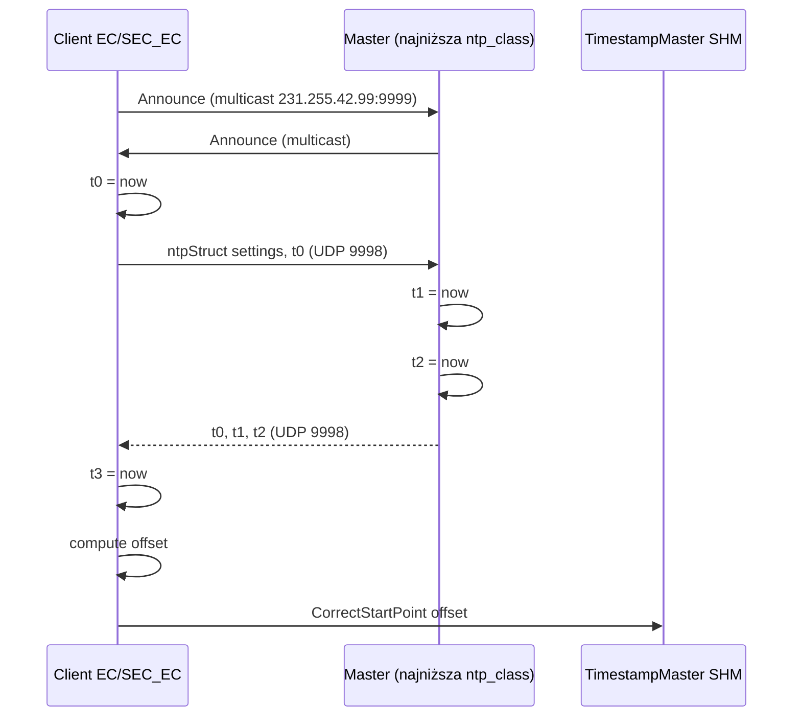

# timestamp_mw

Synchronizacja zegarów między komputerami (tinyNTP po UDP + multicast).

## TL;DR

Każdy węzeł co `T_hb_ms` rozgłasza multicastem (`231.255.42.99:9999`) swoją klasę. Węzeł z najniższą `ntp_class` jest masterem; pozostałe wysyłają do niego unicastem UDP (port 9998) t0, dostają ostemplowaną odpowiedź i wołają `TimestampMaster::CorrectStartPoint(offset)`. Aplikacje potem czytają już skorygowany czas przez `core/timestamp` (SHM).

## Opis funkcjonalności

Rola nie jest stała — wynika z wyboru mastera (`DiscoveryManager::GetBestMaster`): najniższa `ntp_class`, przy remisie węzeł bez holdover, potem najniższe IP. Węzeł nie słyszany przez 15 s znika z listy. Węzeł bez lepszego sąsiada działa jako **master**.

- **Master** — w callbacku UDP wypełnia `t1` (odbiór) i `t2` (wysyłka) i odsyła ramkę.
- **Client** — w pętli co `T_hb_ms`: wyślij `t0` do mastera, po odpowiedzi licz offset i RTT. Bez synchronizacji przez >5 s węzeł oznacza się jako holdover.

Wzory:

- offset = `((T1 − T0) + (T2 − T3)) / 2`
- RTT = `(T3 − T0) − (T2 − T1)`

`Run()` serwisu tylko czeka na stop token — NTP działa w kontrolerze.

## Architektura

Brak IPC MW i braku SOME/IP. To nie jest klient dla aplikacji — aplikacje używają `TimestampController`.

## Protokół UDP

| Stała | Wartość |
|-------|---------|
| Unicast sync (RX i TX) | UDP 9998 |
| Multicast announce | `231.255.42.99`, port 9999 |
| Okres sync i announce | `T_hb_ms` z konfiguracji (deployment: 1000 ms) |
| Timeout węzła | 15 s |

Ramka `ntpStruct` (33 B): `settings:u8`, `t0…t3:int64`. `settings`: bity 0–2 klasa urządzenia, bit 3 holdover, bit 6 typ (0 sync, 1 announce).

## Konfiguracja

- `/srp/opt/cpu_srp/ntp_config.json` (źródło: `deployment/cpu/<cpu>/ntp_config.json`): `ip` (własne IP), `ntp_class` (0–7, wyższe → 7; niższa = lepszy master), `T_hb_ms`. W deploymencie: EC `192.168.10.51` klasa 4, FC `192.168.10.52` klasa 3.
- `deployment/mw/timestamp_mw/app_config.json` (FG: Platform, MW, Running, SafetyMode)

## Diagnostyka

Brak DID.

## Zależności

`//core/timestamp:timestamp_controller`, `UdpSocket`, `UdpMulticastSocket`.

## BUILD

| Target | Rodzaj |
|--------|--------|
| `//mw/timestamp_mw/service:timestamp_mw` | binary |
| `//mw/timestamp_mw/ntp/controller:ntp_controller` | lib |
| `//deployment/mw/timestamp_mw:timestamp_service` | adaptive_application |
