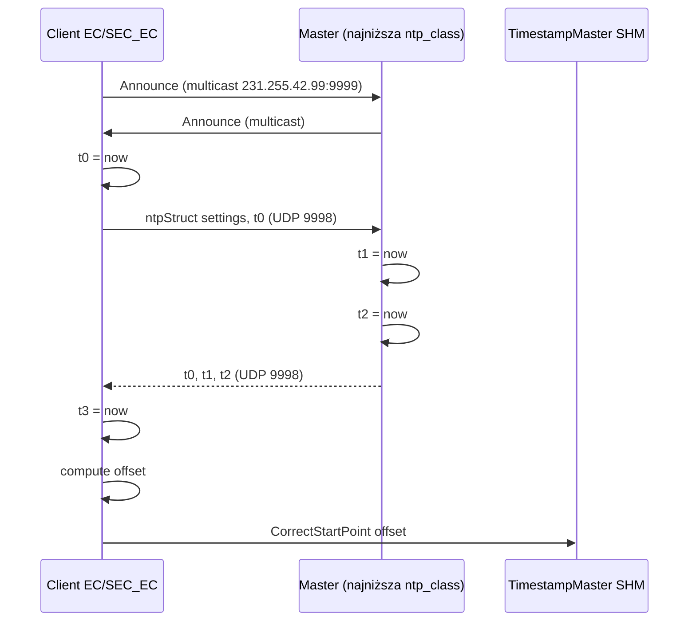
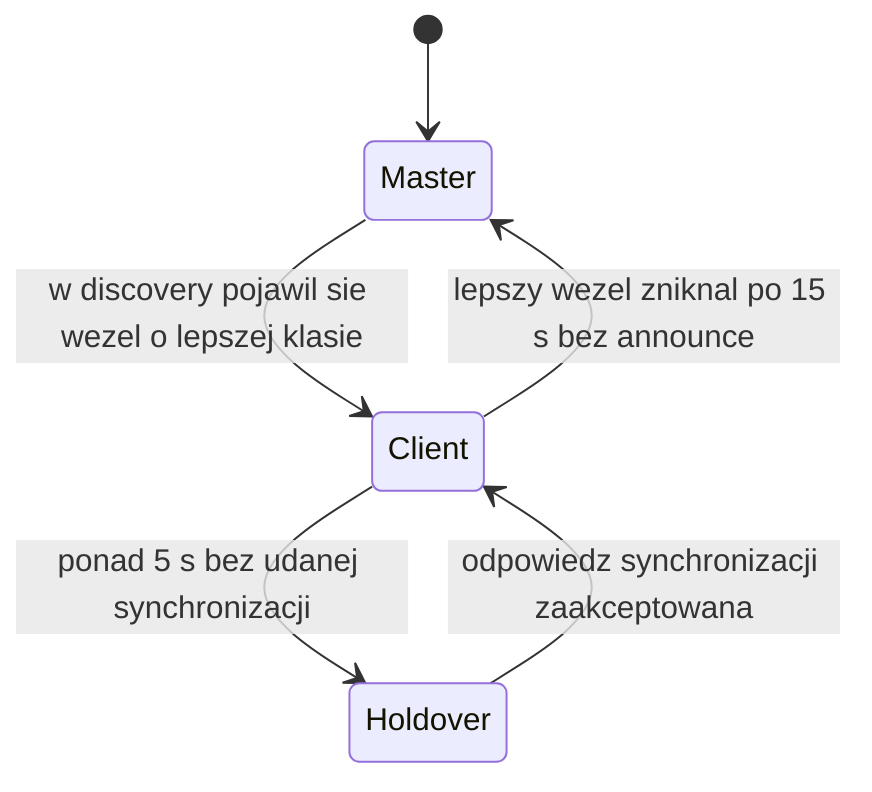

# timestamp_mw

Synchronizacja zegarów między komputerami (tinyNTP po UDP + multicast).

## TL;DR

Każdy węzeł co `T_hb_ms` rozgłasza multicastem (`231.255.42.99:9999`) swoją klasę. Węzeł z najniższą `ntp_class` jest masterem; pozostałe wysyłają do niego unicastem UDP (port 9998) t0, dostają ostemplowaną odpowiedź i wołają `TimestampMaster::CorrectStartPoint(offset)`. Aplikacje potem czytają już skorygowany czas przez `core/timestamp` (SHM).

## Opis funkcjonalności

Rola nie jest stała — wynika z wyboru mastera (`DiscoveryManager::GetBestMaster`): najniższa `ntp_class`, przy remisie węzeł bez holdover, potem najniższe IP. Węzeł nie słyszany przez 15 s znika z listy. Węzeł bez lepszego sąsiada działa jako **master**.

- **Master** — w callbacku UDP wypełnia `t1` (odbiór) i `t2` (wysyłka) i odsyła ramkę.
- **Client** — w pętli co `T_hb_ms`: wyślij `t0` do mastera, po odpowiedzi licz offset i RTT. Bez synchronizacji przez >5 s węzeł oznacza się jako holdover.

Wzory:

- offset = `((T1 − T0) + (T2 − T3)) / 2`
- RTT = `(T3 − T0) − (T2 − T1)`

`Run()` serwisu tylko czeka na stop token — NTP działa w kontrolerze.

## Architektura

Brak IPC MW i braku SOME/IP. To nie jest klient dla aplikacji — aplikacje używają `TimestampController`.

## Cykl życia

1. `TimestampService::Initialize`: `ConfigManager::LoadConfig()` (domyślnie `/srp/opt/cpu_srp/ntp_config.json`); brak/niepoprawny plik lub brak pola → `LogError` i **zwraca −1** (serwis nie startuje). Następnie `NtpController::Init`.
2. `NtpController::Init`:
   - `timestamp_.Init()` (oferuje SHM i ustawia `start = teraz`; wynik nie jest sprawdzany), `last_sync_ = teraz`;
   - `DiscoveryManager::Init(ip, klasa, holdover)` — niepoprawny adres IP → `LogError`, węzeł lokalny nie jest zainicjalizowany i wątek czyszczący nie startuje;
   - bind socketu UDP (9998) i multicast (9999): błąd tylko loguje (`LogError`), `Init` i tak zwraca `true`;
   - start wątków RX obu gniazd i wątku pętli `thread_loop`.
3. `thread_loop` (okres `T_hb_ms`):
   - `SendAnnounce()` (multicast: klasa, flaga holdover);
   - brak lepszego sąsiada → rola **master**; jeśli był holdover, zdejmuje flagę;
   - inaczej → rola **client**: gdy `teraz − last_sync_ > 5000 ms` ustawia holdover; wysyła `SendSyncRequest(ip mastera)` (`t0 = teraz`, zapamiętane w `last_t0_`).
4. `Run`: `wait(token)`; wątki kończą się z destruktorami.

## Sekwencja po stronie mastera i klienta

- Master dla żądania z `t1 == t2 == 0`: `t1 = czas odbioru`, `t2 = czas tuż przed wysyłką`, odpowiedź na adres nadawcy. Odpowiedź (ramka z `t1`/`t2` ≠ 0) odebrana przez mastera jest ignorowana.
- Klient akceptuje odpowiedź tylko, gdy `t1 != 0`, `t2 != 0` oraz `t0 == last_t0_`; liczy `offset` i RTT, woła `CorrectStartPoint(offset)` (`start -= offset`, ponowne `Send` do SHM), kopiuje flagę holdover mastera i ustawia `last_sync_`.
- Pakiety własne (ten sam adres IP) i o rozmiarze ≠ 33 B są odrzucane; ramka typu „announce” na gnieździe unicast (lub odwrotnie) — `Warn` i odrzucenie.

## Przepływ danych (jednostki)

Wszystkie znaczniki `t0…t3` to `int64` w **ms** (`TimestampController::GetNewTimeStamp()` = `GetNow() − start`, gdzie `GetNow()` to milisekundy zegara `high_resolution_clock`). Offset jest dzielony całkowicie przez 2 (rozdzielczość 1 ms) i odejmowany od `start` lokalnego `TimestampMaster`, więc czas lokalny po korekcie jest zrównany z czasem mastera (`ts + offset`).

## Protokół UDP

| Stała | Wartość |
|-------|---------|
| Unicast sync (RX i TX) | UDP 9998 |
| Multicast announce | `231.255.42.99`, port 9999 |
| Okres sync i announce | `T_hb_ms` z konfiguracji (deployment: 1000 ms) |
| Timeout węzła | 15 s |
| Holdover klienta | 5 s bez synchronizacji |

Ramka `ntpStruct` (33 B): `settings:u8`, `t0…t3:int64`. `settings`: bity 0–2 klasa urządzenia, bit 3 holdover, bity 4–5 wersja (0), bit 6 typ (0 sync, 1 announce).

## Obsługa błędów

| Sytuacja | Zachowanie |
|----------|------------|
| brak configu | serwis zwraca −1 |
| `ntp_class > 7` | `Warn`, klasa 7 |
| bind UDP lub multicast nieudany | `LogError`, serwis działa dalej (bez tej części protokołu) |
| zły rozmiar pakietu / własny pakiet / zły typ | pakiet odrzucony |
| brak odpowiedzi mastera | brak korekty; po 5 s holdover, flaga rozgłaszana w announce |
| odpowiedź na stare żądanie (`t0 != last_t0_`) | `Warn`, odrzucona |
| master zniknął (15 s) | węzeł o najlepszych parametrach z pozostałych (lub on sam) przejmuje rolę |

Błędy sieci nie zatrzymują lokalnego zegara: aplikacje nadal widzą czas z SHM, po prostu nieskorygowany.

## Konfiguracja

- `/srp/opt/cpu_srp/ntp_config.json` (źródło: `deployment/cpu/<cpu>/ntp_config.json`):

| Pole | Typ | Jednostka | Opis |
|------|-----|-----------|------|
| `ip` | string | — | własne IP węzła (adres bind i klucz w discovery) |
| `ntp_class` | uint8 | 0–7 | niższa = lepszy master; >7 → 7 |
| `T_hb_ms` | uint32 | ms | okres announce i sync |

W deploymencie: EC `192.168.10.51` klasa 4, FC `192.168.10.52` klasa 3.
- `deployment/mw/timestamp_mw/app_config.json` (FG: Platform, MW, Running, SafetyMode)

## Diagnostyka

Brak DID.

## Zależności

`//core/timestamp:timestamp_controller`, `UdpSocket`, `UdpMulticastSocket`.

## BUILD

| Target | Rodzaj |
|--------|--------|
| `//mw/timestamp_mw/service:timestamp_mw` | binary |
| `//mw/timestamp_mw/ntp/controller:ntp_controller` | lib |
| `//deployment/mw/timestamp_mw:timestamp_service` | adaptive_application |

Testy: `bazel test //mw/timestamp_mw/ntp/ut:controller_test //mw/timestamp_mw/ntp/ut:discovery_manager_test //mw/timestamp_mw/ntp/ut:config_manager_test`.
